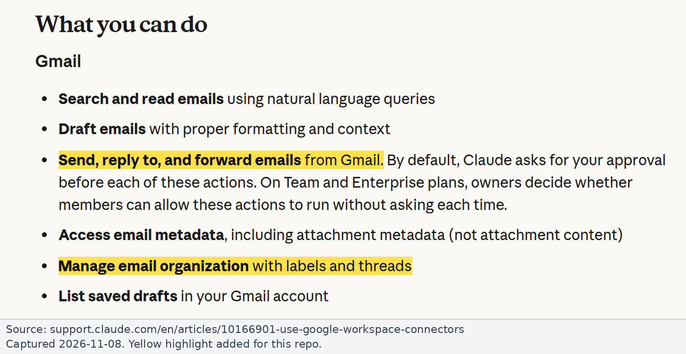
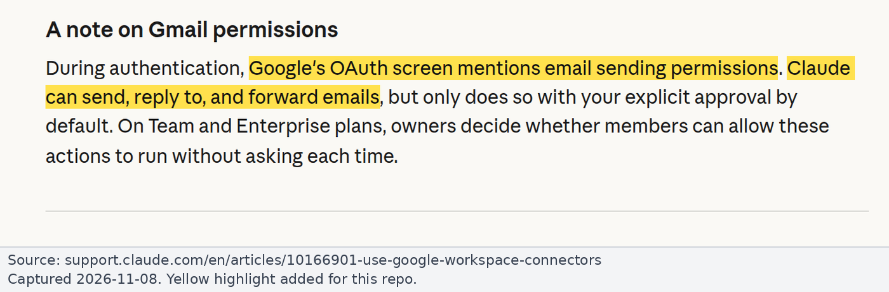
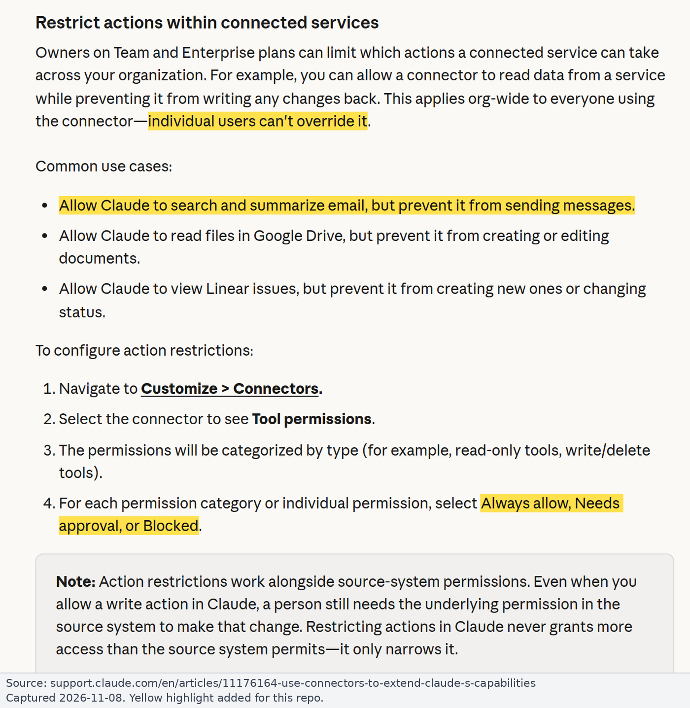
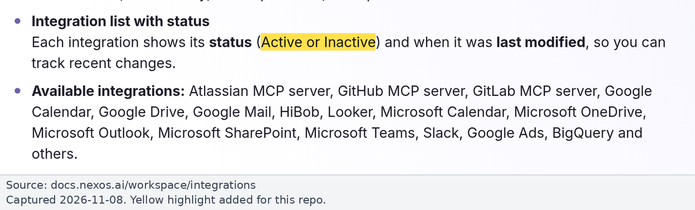
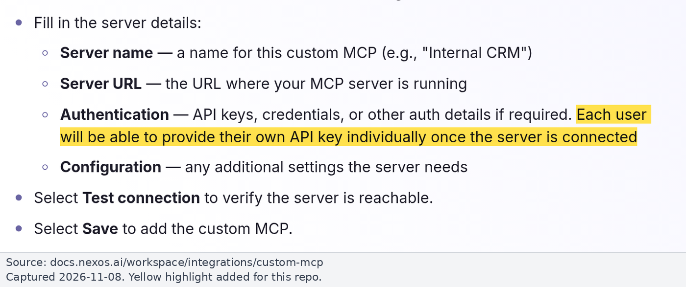
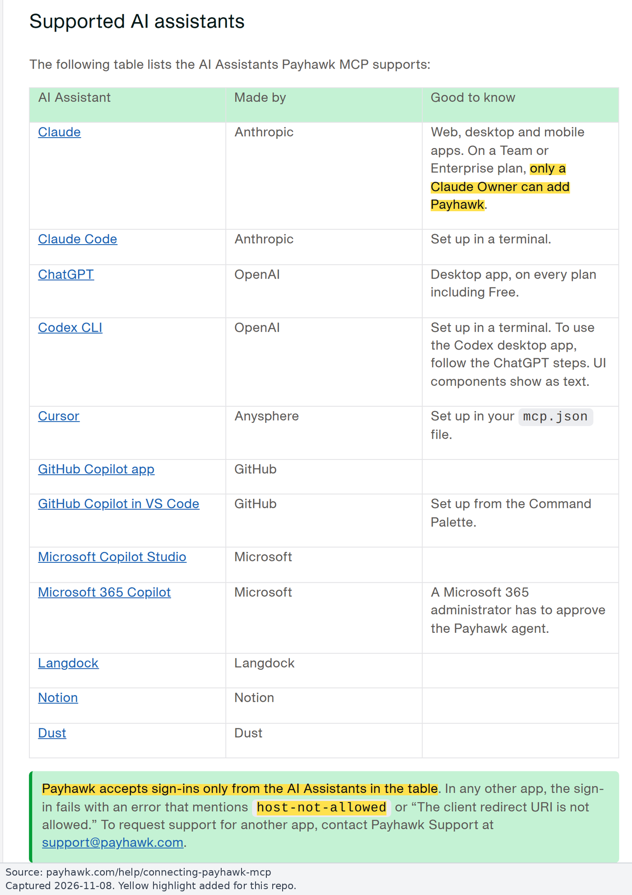

# Findings: read-only Gmail and Payhawk in Claude and nexos.ai

How to give Claude (Team or Enterprise: claude.ai, Desktop, mobile, Claude Code) and nexos.ai read-only access to Gmail and Payhawk. The guard built from this research is [MCP Guard](../README.md). Sources were checked on 2026-11-08; screenshots are from that day, highlights added.

Labels: **Verified** = in official vendor docs (linked). **Community** = seen by users in public GitHub issues. **Inferred** = our reasoning; test before relying on it. **[GWA]** = needs a Google Workspace admin ([runbook](runbooks/google-workspace-admin.md)).

## 1. Answer

**Recommendation: reach Gmail only with a Google token that holds `gmail.readonly`, issued to an OAuth client we own (MCP Guard), and block the vendors' own Gmail apps at Google.** Google then refuses every write, whatever the AI client does.

| | Gmail | Payhawk |
|---|---|---|
| **Claude** (Team or Enterprise) | An Owner adds MCP Guard as a custom connector. The built-in Gmail connector stays off. A Google admin blocks "Claude for Gmail" [GWA] | An Owner adds Payhawk's own MCP as a custom connector and sets every write tool to **Blocked**. No proxy needed |
| **Claude Code** | Managed settings allow only the guard ([4.2](#42-claude-code)) | Same org tool policy as Claude |
| **nexos.ai** | Built-in Gmail integration **Inactive**. MCP Guard added as a custom MCP, each user with a personal key | Not possible today: Payhawk [accepts sign-ins only from listed apps](https://payhawk.com/help/connecting-payhawk-mcp#supported-ai-assistants), and nexos is not one |

Why not just the built-in Gmail connector?

- An Owner **can** set its write tools to **Blocked** on Team and Enterprise. Anthropic enforces it on its servers; members can't override it ([3.3](#33-per-tool-admin-controls-team-vs-enterprise)).
- But its Google grant still includes send permission (`gmail.compose`), so read-only rests only on Anthropic's policy layer ([8.3](#83-residual-risks-of-82-why-81-is-the-guarantee)). Anthropic's own docs disagree on whether it can send ([3.1](#31-what-the-connector-exposes)).
- If the team accepts that, it is a valid no-code option ([8.2](#82-lighter-option-built-in-connector-anthropic-enforced-read-only)).

**Team vs Enterprise:** both have the org-wide Blocked policy. Enterprise adds custom roles and a verified-domain restriction that keeps personal Claude accounts off work Gmail. On Team (our believed plan), only the Google admin blocking "Claude for Gmail" closes that gap.

**nexos.ai** can only [switch a whole integration on or off](https://docs.nexos.ai/workspace/integrations#activate-or-deactivate-an-integration). No per-tool limits; approvals are [advisory](https://docs.nexos.ai/workspace/agents/human-in-the-loop-hitl-approvals#what-you-can-do).

Decisions still open: [questions.md](questions.md).

## 2. All options compared

"Enforced" means a technical control rejects the action. "Advisory" means it relies on a person clicking correctly, or on a hint. "Bypass" asks whether a normal member can get around it.

| # | Option | Where | Enforced? | Bypass? | Effort | Source |
|---|---|---|---|---|---|---|
| 1 | **Claude org tool policy:** Gmail write tools **Blocked** | All Claude surfaces; Team + Enterprise | **Yes, by Anthropic's servers.** The Google token can still send | No. Escapes: a personal Claude account (Team), other apps with Gmail access | Low | [Use connectors](https://support.claude.com/en/articles/11176164-use-connectors-to-extend-claude-s-capabilities#h_9fa8289074), [Claude Code MCP](https://code.claude.com/docs/en/mcp#organization-controls-on-connector-tools) |
| 2 | **Enterprise custom roles:** per-role connector and tool grants | Same; Enterprise only | Yes, server-side, under the org policy | No | Low-Med | [Custom roles](https://support.claude.com/en/articles/13930452-manage-custom-roles-on-enterprise-plans#h_979e558d00) |
| 3 | Claude tool set to **Needs approval** | Same | Advisory. Research mode skips approval; reported skipped in Claude Code | Member approves | Low | [Custom connectors](https://support.claude.com/en/articles/11175166-get-started-with-custom-connectors-using-remote-mcp#h_2d88678c54), [#89304](https://github.com/anthropics/claude-code/issues/89304) |
| 4 | Member's own connector toggle and tool permissions | All plans | Advisory | Yes | None | [Getting started](https://claude.com/docs/connectors/getting-started#manage-or-disconnect-a-connector) |
| 5 | **Claude Code managed deny rules** | Claude Code; server-managed (Team + Enterprise) or MDM (any plan) | Yes, by the client | With MDM, no. Server-managed only: yes, via an API key or gateway. Don't match in Desktop local sessions (#92787) | Low | [Permissions](https://code.claude.com/docs/en/permissions#settings-precedence), [Server-managed settings](https://code.claude.com/docs/en/server-managed-settings#security-considerations) |
| 6 | **Claude Code managed MCP allowlist / denylist** | Claude Code | Yes, by the client | As row 5 | Low | [Managed MCP](https://code.claude.com/docs/en/managed-mcp#policy-based-control-with-allowlists-and-denylists) |
| 7 | **Claude Code managed `PreToolUse` hook** denying write tools, plus `allowManagedHooksOnly` | Claude Code | Yes, by the client | With MDM, no | Med | [Hooks](https://code.claude.com/docs/en/permissions#extend-permissions-with-hooks), [Settings](https://code.claude.com/docs/en/settings-reference#allowmanagedhooksonly) |
| 8 | **Claude Desktop policies:** local MCP off, extensions blocked or allowlisted, `forceLoginOrgUUID` | Desktop; MDM (Enterprise also Organization settings) | Yes, by the client | With MDM, no | Low | [Desktop config](https://support.claude.com/en/articles/12622667-enterprise-configuration-for-claude-desktop#h_003283c7cb), [Local MCP](https://support.claude.com/en/articles/10949351-getting-started-with-local-mcp-servers-on-claude-desktop#h_17d0fb22f8) |
| 9 | Claude API `mcp_toolset` allowlist; Agent SDK `disallowed_tools` / `canUseTool` (`allowed_tools` alone doesn't block other tools) | API, Agent SDK | Yes, by the API and your code | Developer-controlled | Low | [MCP connector](https://platform.claude.com/docs/en/agents-and-tools/mcp-connector#allowlist-enable-only-specific-tools), [SDK permissions](https://code.claude.com/docs/en/agent-sdk/permissions#allow-and-deny-rules) |
| 10 | **nexos.ai integration Active / Inactive** | nexos | Yes, whole integration only | No | Low | [Integrations](https://docs.nexos.ai/workspace/integrations#activate-or-deactivate-an-integration) |
| 11 | nexos.ai approvals (HITL) | nexos agents and chat | Advisory | Yes ("Always approve") | Low | [HITL](https://docs.nexos.ai/workspace/agents/human-in-the-loop-hitl-approvals#what-you-can-do) |
| 12 | **Token with only `gmail.readonly`** (needs our own OAuth client) | Any client | **Hard: Google rejects writes** | No | Med | [Gmail scopes](https://developers.google.com/workspace/gmail/api/auth/scopes#restricted-scopes) |
| 13 | **Google API controls** [GWA]: per app Trusted / Specific Google data / Blocked; Gmail Restricted | Any client using Google OAuth | **Hard (Google)** | No | Low | [App access](https://knowledge.workspace.google.com/admin/apps/control-which-apps-access-google-workspace-data#trustorlimit) |
| 14 | Domain-wide delegation limited to `gmail.readonly` [GWA, super admin] | Server-side apps | Hard scope floor, but can impersonate any user | No | Med | [DWD](https://knowledge.workspace.google.com/admin/apps/control-api-access-with-domain-wide-delegation#before-you-begin) |
| 15 | **Google's Gmail MCP** (Developer Preview) as a custom connector with our own OAuth client | Claude, Claude Code; nexos unlikely (API keys only) | Hard **if** the token is readonly-only (untested) | No | Med | [Gmail MCP](https://developers.google.com/workspace/gmail/api/guides/configure-mcp-server#claude) |
| 16 | **Custom read-only proxy** ([MCP Guard](../README.md)) | Claude, Claude Code, nexos, any MCP client | **Hard:** default-deny tools and a `gmail.readonly` token | No, once the built-in connector is blocked | Med-High | [Design](proxy-design.md) |
| 17 | MCP tool annotations (`readOnlyHint`) | All | Advisory: the spec says treat them as untrusted | n/a | None | [MCP spec](https://modelcontextprotocol.io/specification/2026-07-28/server/tools#:~:text=clients%20MUST%20consider%20tool%20annotations%20to%20be%20untrusted) |
| 18 | **Cloudflare MCP server portal** with an allowlist and per-user upstream OAuth | OAuth MCP clients; needs Cloudflare Zero Trust | Yes, at the gateway; scope floor if it requests only `gmail.readonly` | No | Med (no code) | [MCP portals](https://developers.cloudflare.com/cloudflare-one/access-controls/ai-controls/mcp-portals/#use-an-allowlist-pattern), [per-user OAuth](https://developers.cloudflare.com/cloudflare-one/access-controls/ai-controls/mcp-portals/#portal-callback-url) |
| 19 | Other gateways (agentgateway, ContextForge, Docker MCP Gateway) | Depends | Yes, at the gateway | No | Med-High | [Build vs buy](proxy-design.md#reuse-an-existing-gateway-or-build) |

## 3. Can the built-in Gmail connector be restricted to read-only?

Its tools, yes (Blocked). Its Google credential, no.

### 3.1 What the connector exposes

Anthropic's docs disagree:

- The help article [Use Google Workspace connectors](https://support.claude.com/en/articles/10166901-use-google-workspace-connectors#h_313efcfd44) lists search and read, drafts, **send, reply and forward**, and label and thread management.
- The [Claude docs Gmail page](https://claude.com/docs/connectors/google/gmail#:~:text=Claude%20reads%20and%20searches%20email%20only) says: "Claude reads and searches email only; it can't create, send, or modify messages."

The help article matches the community reports below, so treat the connector as **able to write**.

*Source: [Anthropic Help Center](https://support.claude.com/en/articles/10166901-use-google-workspace-connectors#h_313efcfd44).*

Anthropic publishes no tool list. GitHub issues ([#89304](https://github.com/anthropics/claude-code/issues/89304), [#72052](https://github.com/anthropics/claude-code/issues/72052), [#47383](https://github.com/anthropics/claude-code/issues/47383)) show `send_message`, `reply`, `forward`, `create_draft`, `update_draft`, `trash_message`, `trash_thread`, `mark_message_spam`, `mark_thread_spam` and label tools. One user reports `send_message` succeeded from Claude Code. **Community.**

### 3.2 Which OAuth scopes it gets

- **Verified:** "Google's OAuth screen mentions email sending permissions" ([10166901](https://support.claude.com/en/articles/10166901-use-google-workspace-connectors#h_60ffa285c8)).
- **Community:** users' Google permissions pages show "Claude for Gmail" with "Manage drafts and send emails" and "View your email messages and settings" ([#46206](https://github.com/anthropics/claude-code/issues/46206), [#55271](https://github.com/anthropics/claude-code/issues/55271)), that is `gmail.compose` and `gmail.readonly`. Send and draft work; label and trash fail without `gmail.modify`.
- **No Claude setting narrows it.** Enterprise-managed auth has a [scopes step](https://support.claude.com/en/articles/15537633-auto-connect-your-organization-s-apps-to-claude#h_53dd1f8864), but not for Gmail ([15537633](https://support.claude.com/en/articles/15537633-auto-connect-your-organization-s-apps-to-claude#h_9a446f251c)).
- **Check our tenant [GWA]:** API controls > Manage Third-Party App Access > [Accessed apps](https://knowledge.workspace.google.com/admin/apps/control-which-apps-access-google-workspace-data#reviewapps) > "Claude for Gmail" shows its scopes.

*Source: [Anthropic Help Center](https://support.claude.com/en/articles/10166901-use-google-workspace-connectors#h_60ffa285c8).*

What we can do about it:

- **Accept it**, relying on Anthropic's Blocked policy ([8.3](#83-residual-risks-of-82-why-81-is-the-guarantee)).
- **Limit "Claude for Gmail" to `gmail.readonly` at Google** [GWA]. It always asks for `gmail.compose` too, so sign-in will likely just fail (**Inferred**; pilot on one OU).
- **Block "Claude for Gmail" at Google** [GWA] and use an OAuth client we own. **Recommended.**
- Ask Anthropic for a read-only variant (related GitHub issues closed as stale).

### 3.3 Per-tool admin controls, Team vs Enterprise

| Control | Team | Enterprise |
|---|---|---|
| Enable or remove Gmail for the org; members still sign in to Google themselves ([11176164](https://support.claude.com/en/articles/11176164-use-connectors-to-extend-claude-s-capabilities#h_b6f69dbd72)) | Yes | Yes |
| **Org-wide policy per tool or group: Always allow / Needs approval / Blocked.** "Individual users can't override it" ([11176164](https://support.claude.com/en/articles/11176164-use-connectors-to-extend-claude-s-capabilities#h_9fa8289074)) | **Yes** | **Yes** |
| Per-role grants. "Blocked: The connector or tool is hidden. Claude can't see it or call it." ([13930452](https://support.claude.com/en/articles/13930452-manage-custom-roles-on-enterprise-plans#h_fb6a5a0907)) | No | **Yes** |
| Restrict verified-domain connectors: personal Claude accounts can't connect work Gmail; [not retroactive](https://support.claude.com/en/articles/15402193-restrict-verified-domain-connectors-to-your-enterprise#h_077f0599f4) ([15402193](https://support.claude.com/en/articles/15402193-restrict-verified-domain-connectors-to-your-enterprise#h_154f8902a3)) | No | **Yes** |
| Member connector requests; an Owner can "Decline it and block the connector" ([11176164](https://support.claude.com/en/articles/11176164-use-connectors-to-extend-claude-s-capabilities#h_9213598058)) | On by default | Off by default |

*Source: [Anthropic Help Center](https://support.claude.com/en/articles/11176164-use-connectors-to-extend-claude-s-capabilities#h_9fa8289074).*

"Connector permissions are enforced on Anthropic's servers" on every Claude surface, and "[Access fails toward denying, never toward granting.](https://support.claude.com/en/articles/13930452-manage-custom-roles-on-enterprise-plans#:~:text=Access%20fails%20toward%20denying%2C%20never%20toward%20granting)" Locally run connectors aren't covered ([13930452](https://support.claude.com/en/articles/13930452-manage-custom-roles-on-enterprise-plans#h_fc529fed57)).

**Use Blocked, not Needs approval:** Research mode calls tools "automatically without further approval" ([11175166](https://support.claude.com/en/articles/11175166-get-started-with-custom-connectors-using-remote-mcp#h_2d88678c54)), Desktop's local Claude Code sessions get only `blocked` ([mcp.md](https://code.claude.com/docs/en/mcp#organization-controls-on-connector-tools)), and users report approvals not shown in Claude Code (#89304, **Community**).

**Block the whole write/delete group**, not single tools: the docs don't say what default a new tool gets (that the group catches it is **Inferred**). The grouping likely follows MCP annotations ([review criteria](https://claude.com/docs/connectors/building/review-criteria#provide-tool-annotations)), so check each tool once.

### 3.4 Setup steps for the built-in route (Claude Owner)

Add Gmail under Organization settings > Connectors, then in its **Tool permissions** set the write/delete group and every send, reply, forward, draft, trash, spam and label tool to **Blocked** ([11176164](https://support.claude.com/en/articles/11176164-use-connectors-to-extend-claude-s-capabilities#h_9fa8289074)). Claude Code [applies this on its own](https://code.claude.com/docs/en/mcp#organization-controls-on-connector-tools). Enterprise: turn on the verified-domain restriction. [GWA] set "Claude for Gmail" to Trusted for the OUs that use it, or users may see ["Access blocked"](https://support.claude.com/en/articles/10166901-use-google-workspace-connectors#h_c56f0774e8). Full steps: [runbooks/claude-org.md](runbooks/claude-org.md#route-a-built-in-gmail-connector-with-write-tools-blocked).

## 4. Claude surfaces in detail

### 4.1 claude.ai web, desktop chat and mobile (Team and Enterprise)

- **Only Owners add custom connectors** (on Enterprise also custom roles with Libraries "Manage"), so members can't add an unrestricted Gmail MCP ([11175166](https://support.claude.com/en/articles/11175166-get-started-with-custom-connectors-using-remote-mcp#h_3d1a65aded)).
- **Custom connectors are called from Anthropic's cloud**, so the server must be public or behind [MCP tunnels](https://claude.com/docs/connectors/mcp-tunnels/overview#decide-when-to-use-an-mcp-tunnel). OAuth client options: **"Use Claude's published identity"** (CIMD, Anthropic's recommended option), "Register automatically" (DCR), or "Use your own OAuth client" ([11176164](https://support.claude.com/en/articles/11176164-use-connectors-to-extend-claude-s-capabilities#h_4201f9e625)).
- **The org tool policy covers org-added custom connectors too**, such as Payhawk or the guard ([13930452](https://support.claude.com/en/articles/13930452-manage-custom-roles-on-enterprise-plans#h_fc529fed57)).

### 4.2 Claude Code

Claude Code loads claude.ai connectors only with a claude.ai login ([mcp.md](https://code.claude.com/docs/en/mcp#use-mcp-servers-from-claude-ai)). Server-managed settings follow the credential: a Console API key gets its own Console org's settings, not the claude.ai org's, and a third-party provider or a custom `ANTHROPIC_BASE_URL` skips the fetch ([server-managed settings](https://code.claude.com/docs/en/server-managed-settings#platform-availability)). nexos documents running Claude Code through its gateway that way ([nexos](https://docs.nexos.ai/gateway-api/integrations/claude-code#id-2.-connect-claude-code-to-nexos.ai)). **Only MDM or file-deployed managed settings govern those sessions.**

| Control | What it does |
|---|---|
| Org tool policy | `blocked` tools are filtered out; `ask` prompts every call ([mcp.md](https://code.claude.com/docs/en/mcp#organization-controls-on-connector-tools)) |
| Deny rules | e.g. `mcp__claude_ai_Gmail__*`. A deny from any level wins; managed rules can't be overridden ([permissions.md](https://code.claude.com/docs/en/permissions#settings-precedence)) |
| MCP allowlist | `allowManagedMcpServersOnly` + `allowedMcpServers` by `serverUrl` (`serverName` is ["not a security control"](https://code.claude.com/docs/en/managed-mcp#how-servername-entries-match)); `deniedMcpServers` [always wins](https://code.claude.com/docs/en/managed-mcp#how-a-server-is-evaluated) ([managed-mcp.md](https://code.claude.com/docs/en/managed-mcp#policy-based-control-with-allowlists-and-denylists)) |
| `managed-mcp.json` | [Loads only listed servers and drops claude.ai connectors](https://code.claude.com/docs/en/managed-mcp#exclusive-control-with-managed-mcp-json). [MDM file only](https://code.claude.com/docs/en/managed-mcp#deploy-managed-mcp-json) |
| OAuth scope pin | `"oauth": {"scopes": "...gmail.readonly"}` for user-added servers ([mcp.md](https://code.claude.com/docs/en/mcp#restrict-oauth-scopes)) |

MDM reaches every session on the device, though not cloud sessions in Anthropic-hosted environments; "[Endpoint-managed settings provide stronger security guarantees.](https://code.claude.com/docs/en/server-managed-settings#choose-between-server-managed-and-endpoint-managed-settings)"

**Known gap (Community, [#92787](https://github.com/anthropics/claude-code/issues/92787), open):** in Desktop's Code tab, local sessions name connector tools `mcp__<uuid>__send_message`, so `mcp__claude_ai_Gmail__*` rules don't match. The org `blocked` policy is the reliable control there.

Examples: [runbooks/claude-code-managed-settings.md](runbooks/claude-code-managed-settings.md).

### 4.3 Claude Desktop, API and Agent SDK

- **Desktop** ([12622667](https://support.claude.com/en/articles/12622667-enterprise-configuration-for-claude-desktop#h_003283c7cb)): `isLocalDevMcpEnabled=false` stops user-added local MCP servers, extensions can be blocked or allowlisted, and `forceLoginOrgUUID` keeps personal accounts out. Team needs MDM.
- **API and Agent SDK:** developer-side tool allowlists (row 9 above), outside the claude.ai org policy.

## 5. nexos.ai

All **Verified** from [docs.nexos.ai](https://docs.nexos.ai/workspace/integrations):

- **Built-in Gmail:** members connect their own Google account; its tools and scopes are **not documented** ([Gmail](https://docs.nexos.ai/workspace/integrations/gmail#setting-up-the-integration-as-an-admin)).
- **Org controls:** each integration is Active or Inactive. No per-tool toggle, and no team-level limit: "Apps remain managed at the company level" ([Roles](https://docs.nexos.ai/workspace/settings/organization/roles-and-permissions#team-owner)).
- **Approvals (HITL):** agents pause before "[an action that changes something in another tool](https://docs.nexos.ai/workspace/agents/human-in-the-loop-hitl-approvals#:~:text=an%20action%20that%20changes%20something%20in%20another%20tool)", but users can pick "Always approve", so it is **advisory** ([HITL](https://docs.nexos.ai/workspace/agents/human-in-the-loop-hitl-approvals#what-you-can-do)).
- **Custom MCP:** [Streamable HTTP only, reachable from the internet](https://docs.nexos.ai/workspace/integrations/custom-mcp#:~:text=nexos.ai%20currently%20supports%20only%20streamable%20HTTP). Auth is per-user API keys: "[Each user will be able to provide their own API key individually.](https://docs.nexos.ai/workspace/integrations/custom-mcp#add-the-custom-mcp-to-nexos.ai)" [Org-wide once enabled](https://docs.nexos.ai/workspace/integrations/custom-mcp#faq); [IP allowlisting on request](https://docs.nexos.ai/workspace/integrations/custom-mcp#use-the-custom-mcp). **No OAuth and no per-tool limits documented** ([Custom MCP](https://docs.nexos.ai/workspace/integrations/custom-mcp)).

*Source: [nexos.ai docs, Integrations](https://docs.nexos.ai/workspace/integrations#what-you-will-find-on-this-page).*

*Source: [nexos.ai docs, Custom MCP](https://docs.nexos.ai/workspace/integrations/custom-mcp#add-the-custom-mcp-to-nexos.ai).*

**What works:** built-in Gmail Inactive, the guard as a custom MCP with personal keys ([nexos-setup.md](nexos-setup.md)), and nexos's Gmail app blocked at Google [GWA]. Untested: whether a key entered at setup becomes a default for members (everyone would then read that mailbox); test with a throwaway account.

## 6. Provider and infrastructure side

### 6.1 Gmail OAuth scopes

From [Gmail API scopes](https://developers.google.com/workspace/gmail/api/auth/scopes#gmail-scopes):

| Scope | Allows | Class |
|---|---|---|
| `gmail.readonly` | View messages and settings | Restricted |
| `gmail.send` | Send | Sensitive |
| `gmail.compose` | Manage drafts and send | Restricted |
| `gmail.modify` | Read, compose, send (no permanent delete) | Restricted |
| `https://mail.google.com/` | Everything, including permanent delete | Restricted |

A token with only `gmail.readonly` (plus `openid email`) can't send, draft, label or delete, **whatever the client does**. Restricted scopes need Google verification, except for an **Internal** app (GCP project owned by our Workspace org) ([verification exceptions](https://support.google.com/cloud/answer/13464323#:~:text=The%20app%20is%20only%20used%20by%20people%20in%20your%20Google%20Workspace)).

### 6.2 Google Workspace admin controls [GWA]

Admin console > Security > Access and data control > **API controls** ([Google](https://knowledge.workspace.google.com/admin/apps/control-which-apps-access-google-workspace-data#change-access-from-the-app-list); needs the Service Settings admin privilege):

- **Per app, per OU:** Trusted, Limited, **Specific Google data** ("only to scopes that you specify", plus sign-in scopes), or **Blocked** ([Google](https://knowledge.workspace.google.com/admin/apps/control-which-apps-access-google-workspace-data#trustorlimit)).
- **Gmail as a Restricted service:** untrusted apps "[stop working, and tokens are revoked.](https://knowledge.workspace.google.com/admin/apps/control-which-apps-access-google-workspace-data#restrictaccess)" Large blast radius; coordinate first.
- **[Unconfigured apps](https://knowledge.workspace.google.com/admin/apps/control-which-apps-access-google-workspace-data#unconfigured-third-party-apps):** can be limited; leave "[Trust internal apps](https://knowledge.workspace.google.com/admin/apps/control-which-apps-access-google-workspace-data#internal-apps)" unchecked.
- **[Accessed apps](https://knowledge.workspace.google.com/admin/apps/control-which-apps-access-google-workspace-data#reviewapps)** lists apps holding tokens and their scopes, for audits.
- **Domain-wide delegation** ([Google](https://knowledge.workspace.google.com/admin/apps/control-api-access-with-domain-wide-delegation#before-you-begin)) can be limited to `gmail.readonly`, but can impersonate every user. Per-user OAuth is safer.

### 6.3 Google's own Gmail MCP server (Developer Preview)

From [Configure the Gmail MCP server](https://developers.google.com/workspace/gmail/api/guides/configure-mcp-server) and the [MCP reference](https://developers.google.com/workspace/gmail/api/reference/mcp):

- **Endpoint:** `https://gmailmcp.googleapis.com/mcp/v1`, Streamable HTTP, OAuth ([guide](https://developers.google.com/workspace/gmail/api/guides/configure-mcp-server#others)).
- **Requires:** [enrolment in the Workspace Developer Preview Program](https://developers.google.com/workspace/gmail/api/guides/configure-mcp-server#prerequisites) (preview terms); the [Gmail MCP API](https://developers.google.com/workspace/gmail/api/guides/configure-mcp-server#enable-mcp-services) (`gmailmcp.googleapis.com`) enabled; an OAuth client marked "[**Use this client for an AI-powered agent**](https://developers.google.com/workspace/gmail/api/guides/configure-mcp-server#configure-mcp-client)"; and [screening of prompts and responses for prompt injection](https://developers.google.com/workspace/gmail/api/guides/configure-mcp-server#prompt-injection), with Model Armor or your own solution ([Workspace MCP security](https://developers.google.com/workspace/guides/configure-mcp-security#model-armor)).
- **Claude setup:** Web OAuth client with redirect `https://claude.ai/api/mcp/auth_callback`, added as a custom connector with your own client ID and secret ([guide](https://developers.google.com/workspace/gmail/api/guides/configure-mcp-server#claude)).
- **Scopes:** [Google's guide](https://developers.google.com/workspace/gmail/api/guides/configure-mcp-server#configure-consent-screen) requests `gmail.readonly` **and** `gmail.compose`.
- **Tools:** `search_threads`, `get_thread`, `get_message`, `list_labels` and `list_drafts` work with `gmail.readonly` (each tool's page lists its scopes, e.g. [search_threads](https://developers.google.com/workspace/gmail/api/reference/mcp/tools_list/search_threads#authorization-scopes)); draft and label tools need more. **There is no send tool** ([tool list](https://developers.google.com/workspace/gmail/api/reference/mcp#toolsets)).
- Whether Claude's connector can request only `gmail.readonly` isn't documented. A Google admin can enforce it with [Specific Google data](https://knowledge.workspace.google.com/admin/apps/control-which-apps-access-google-workspace-data#trustorlimit) [GWA]; whether sign-in then fails is **untested**.

### 6.4 MCP tool annotations: does anything enforce them?

No. The [MCP spec](https://modelcontextprotocol.io/specification/2026-07-28/server/tools#:~:text=clients%20MUST%20consider%20tool%20annotations%20to%20be%20untrusted) says clients "MUST consider tool annotations to be untrusted unless they come from trusted servers". Claude uses them only for defaults and grouping ([review criteria](https://claude.com/docs/connectors/building/review-criteria#provide-tool-annotations)). A proxy should set them accurately but enforce on its own.

### 6.5 Payhawk MCP

From Payhawk's Help Center: [About](https://payhawk.com/help/payhawk-mcp-overview), [Connecting](https://payhawk.com/help/connecting-payhawk-mcp), [Tool reference](https://payhawk.com/help/payhawk-mcp-tool-reference), [FAQ](https://payhawk.com/help/faq-on-the-payhawk-mcp), [Developer API](https://payhawk.com/help/overview-of-the-payhawk-developer-api).

- **Official and hosted:** `https://mcp.payhawk.com/mcp`, Streamable HTTP ([Connecting](https://payhawk.com/help/connecting-payhawk-mcp#before-you-start)).
- **Auth:** OAuth with the user's own Payhawk login, so Payhawk roles still apply ([About](https://payhawk.com/help/payhawk-mcp-overview#what-makes-the-payhawk-mcp-different)).
- **Client allowlist:** "Payhawk accepts sign-ins only from the AI Assistants in the table" (Claude, Claude Code, ChatGPT, Cursor and others, **not nexos.ai**). Others fail with `host-not-allowed`; requests go to support@payhawk.com ([Connecting](https://payhawk.com/help/connecting-payhawk-mcp#supported-ai-assistants)).
- **Write tools:** [82 tools](https://payhawk.com/help/payhawk-mcp-tool-reference#full-list-of-supported-payhawk-mcp-tools), many write. Writes "[always show a preview and need your confirmation](https://payhawk.com/help/payhawk-mcp-tool-reference#:~:text=They%20always%20show%20a%20preview%20and%20need%20your%20confirmation)" (advisory); it "[never starts a payment or a transfer](https://payhawk.com/help/payhawk-mcp-overview#:~:text=The%20Payhawk%20MCP%20never%20starts%20a%20payment%20or%20a%20transfer)".
- **Developer API:** keys can be **Read-only**, but are account-wide, not per user ([Developer API](https://payhawk.com/help/overview-of-the-payhawk-developer-api#h_8996f3095d)).

*Source: [Payhawk Help Center](https://payhawk.com/help/connecting-payhawk-mcp#supported-ai-assistants).*

The read / write split of all 82 tools is in [runbooks/payhawk.md](runbooks/payhawk.md#tool-classification-82-tools). It is **Inferred from tool names**, so block anything unclear.

## 7. The custom read-only proxy route

Built in this repo as [MCP Guard](../README.md) ([design](proxy-design.md)): a default-deny allowlist, `gmail.readonly` tokens only, the GA Gmail API by default (Google's Gmail MCP by config), OAuth sign-in for Claude and personal keys for nexos. Payhawk wiring and a real deployment are still open ([DEPLOY.md](../DEPLOY.md#open-items)).

## 8. Recommended layered setup

### 8.1 Target: real read-only guarantee (proxy route), Team or Enterprise

1. **Google [GWA]:** only our Internal OAuth client reaches Gmail, limited to `gmail.readonly`; "Claude for Gmail" and nexos's Gmail app Blocked.
2. **Guard:** allowlisted read tools, read-only tokens.
3. **Claude org:** built-in Gmail off (Team: decline and block requests); guard as a custom connector; Payhawk write tools Blocked. Enterprise: custom roles Block Gmail; verified-domain restriction on.
4. **Clients:** Claude Code managed MCP allowlist (server-managed **plus** MDM); Desktop: local MCP off, `forceLoginOrgUUID`.
5. **nexos:** Gmail Inactive; guard as custom MCP.
6. **Monitor:** guard audit log, Google OAuth logs, Accessed apps.

> **Team-plan gap:** without the verified-domain restriction, a member's personal Claude account can connect work Gmail. Only the Google admin blocking "Claude for Gmail" [GWA] closes it.

### 8.2 Lighter option: built-in connector, Anthropic-enforced read-only

Enable Gmail and set its write/delete group to **Blocked** (Claude Code included). Enterprise: verified-domain restriction on. [GWA] set "Claude for Gmail" to Trusted only for the OUs that use it. Fine if the team trusts Anthropic's policy layer.

### 8.3 Residual risks of 8.2 (why 8.1 is the guarantee)

- The token holds `gmail.compose`, which can send. A policy bug or a new unblocked write tool makes sending possible.
- Anthropic's docs disagree about what the connector can do, and its tools change without notice.
- On Team, personal Claude accounts can connect work Gmail unless Google blocks the app (which also blocks the org's use).
- Claude's policy doesn't cover nexos.

## 9. Payhawk-specific recommendation

- **Claude only:** add `https://mcp.payhawk.com/mcp` as an org custom connector and **Block every write and unclear tool**. Enforced server-side, no code, per-user Payhawk permissions kept.
- **nexos, or a credential-level guarantee:** put the guard in front of Payhawk ([design](proxy-design.md#payhawk)). That needs **Payhawk Support to allowlist the guard's redirect URI**; until then sign-in fails with [`host-not-allowed`](https://payhawk.com/help/connecting-payhawk-mcp#supported-ai-assistants).
- [Payhawk roles](https://payhawk.com/help/payhawk-mcp-overview#what-makes-the-payhawk-mcp-different) are another hard floor, per user rather than per tool.

Steps: [runbooks/payhawk.md](runbooks/payhawk.md).

## 10. Method and evidence

No accounts were connected and no consent was given. Pages were fetched with `curl`, GitHub issues with the GitHub CLI. Not captured: nexos.ai/pricing (Cloudflare bot check) and the built-in connector's live tool list (needs a real Google consent). Also used: Anthropic [release notes](https://support.claude.com/en/articles/12138966-release-notes), Claude Code [settings reference](https://code.claude.com/docs/en/settings-reference), nexos [changelog](https://docs.nexos.ai/changelog), MCP [authorization security](https://modelcontextprotocol.io/specification/2026-07-28/basic/authorization/security-considerations). Gateway sources: [proxy-design.md](proxy-design.md#reuse-an-existing-gateway-or-build).
