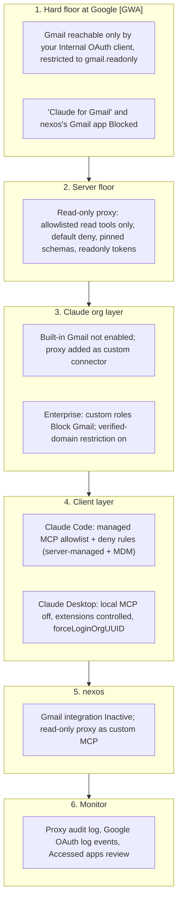

# Findings: read-only MCP tools (Gmail, Payhawk) on Claude Team/Enterprise and nexos.ai

All sources were checked on **2026-11-08** unless a row says otherwise.

## Scope

- "nexos" is **nexos.ai** (confirmed from docs.nexos.ai, see [nexos.ai](#5-nexosai)).
- Surfaces in use: **Claude web/desktop and Claude Code**. Claude API / Agent SDK are covered only briefly.
- Preference: use the **built-in Gmail connector** if it can be restricted; otherwise a **custom read-only proxy MCP**, assuming several proxies over time (Gmail, **Payhawk**, later others).
- The team does **not** control the Google Workspace admin console itself, but colleagues who do can help. Every step that needs a Google Workspace admin is tagged **[GWA]** (consolidated in [the Workspace admin runbook](runbooks/google-workspace-admin.md)).

Evidence labels used throughout:

- **Verified** = stated in official vendor docs (link given).
- **Community** = observed by users in public bug reports (GitHub issues), not stated by the vendor.
- **Inferred** = reasoning from the docs; not stated anywhere. Needs a test before you rely on it.

Contents:

1. [Bottom line](#1-bottom-line)
2. [Comparison table](#2-comparison-table)
3. [Can the built-in Gmail connector be restricted to read-only?](#3-can-the-built-in-gmail-connector-be-restricted-to-read-only)
4. [Claude surfaces in detail](#4-claude-surfaces-in-detail)
5. [nexos.ai](#5-nexosai)
6. [Provider and infrastructure side](#6-provider-and-infrastructure-side)
7. [The custom read-only proxy route](#7-the-custom-read-only-proxy-route)
8. [Recommended layered setup](#8-recommended-layered-setup)
9. [Payhawk-specific recommendation](#9-payhawk-specific-recommendation)
10. [Steps that need a Google Workspace admin](#10-steps-that-need-a-google-workspace-admin-gwa)
11. [Method and evidence](#11-method-and-evidence)
12. [Open questions](#12-open-questions)

---

## 1. Bottom line

1. **Yes, on both Claude Team and Enterprise you can stop the built-in Gmail connector from writing, and users cannot override it.** An Owner sets each Gmail write tool, or the whole "write/delete tools" group, to **Blocked** in the connector's tool permissions. A blocked tool is hidden: Claude can't see it or call it. Anthropic enforces this on its servers across claude.ai web, Claude Desktop (chat, Cowork and Code tab), mobile and Claude Code. Enterprise also lets you set this per custom role. **Verified.**
2. **But this is not a read-only credential.** When a user connects the built-in Gmail connector, Google is asked for send permission. Anthropic's help page says so. Users who checked their Google permissions page found the "Claude for Gmail" grant holds `gmail.readonly` plus `gmail.compose` ("Manage drafts and send emails"). The read-only guarantee therefore sits entirely in Anthropic's tool-policy layer. Nothing at Google stops a send if that layer has a bug or the user reaches Gmail some other way. Scope: **Community** (consistent with the verified "OAuth screen mentions email sending permissions" text).
3. **The built-in Gmail connector's write surface is large.** Anthropic's help page lists send, reply, forward, drafts and label management. Community reports name the tools `send_message`, `reply`, `forward`, `create_draft`, `update_draft`, `trash_message`, `trash_thread`, `mark_message_spam`, `mark_thread_spam` and label tools. Two Anthropic doc pages currently disagree on whether the connector can write at all ([section 3.1](#31-what-the-connector-exposes)).
4. **A real read-only guarantee needs an OAuth token that only holds `gmail.readonly`.** Google then rejects any write, whatever the client does. You can only control the requested scope if **you own the OAuth client**. Two ways do that:
   - (a) **Google's own Gmail MCP server** (`gmailmcp.googleapis.com`, Developer Preview), added as a Claude custom connector with your own Internal OAuth client.
   - (b) **Your own read-only proxy / MCP server.**
5. **nexos.ai has no documented per-tool restriction.** An org can only switch a whole integration Active or Inactive. Human-in-the-loop approvals exist, but each user can flip them to "Always approve". In nexos, the only enforced read-only Gmail is to expose a read-only MCP server as a custom MCP and keep the built-in Gmail integration Inactive. **Verified** (absence of the feature in the docs).
6. **Payhawk:** the official Payhawk MCP is at `https://mcp.payhawk.com/mcp`. Users sign in with their own Payhawk login and keep their Payhawk permissions. It has 82 tools, many of them write tools, and it never moves money. Payhawk only accepts OAuth sign-ins from a fixed list of AI apps. **A self-hosted Payhawk proxy cannot sign users in until Payhawk Support allowlists the proxy's redirect URI.** In Claude, the org tool policy can already block Payhawk's write tools without any proxy.
7. **Recommended setup ([section 8](#8-recommended-layered-setup)):**
   - **Floor:** Gmail access only through an OAuth client you own, holding `gmail.readonly`. A Google Workspace admin restricts that client to `gmail.readonly` and blocks Anthropic's "Claude for Gmail" app [GWA].
   - **Claude:** the read-only connector is added by an Owner, and the built-in Gmail connector stays disabled.
   - **Claude Code:** locked to an MCP allowlist through managed settings.
   - **nexos:** gets the same read-only server as a custom MCP.

   If the team accepts Anthropic-enforced (not credential-enforced) read-only, the built-in connector with write tools Blocked is a valid lighter option on both plans. [Section 8.3](#83-residual-risks-of-82-why-81-is-the-guarantee) lists the residual risks.

---

## 2. Comparison table

The full comparison table (19 solutions, with enforcement level, bypassability, effort and references) is in the [README](../README.md#comparison-of-solutions).

---

## 3. Can the built-in Gmail connector be restricted to read-only?

### 3.1 What the connector exposes

**Official, and contradictory:**

- The help article [Use Google Workspace connectors](https://support.claude.com/en/articles/10166901-use-google-workspace-connectors) (updated "over a week ago") lists: search and read; draft; **send, reply to, and forward** ("By default, Claude asks for your approval before each of these actions. On Team and Enterprise plans, owners decide whether members can allow these actions to run without asking each time"); attachment metadata; **manage labels and threads**; list drafts. It also says: "During authentication, Google's OAuth screen mentions email sending permissions."
- The page [claude.com/docs/connectors/google/gmail](https://claude.com/docs/connectors/google/gmail.md) still says: "Claude reads and searches email only; it can't create, send, or modify messages."
- The two Anthropic pages contradict each other. The help article plus the community evidence below point to the read-only docs page being stale. Treat the connector as **able to write**.

**Community-observed tool names** (Anthropic publishes no tool list; GitHub issues on `anthropics/claude-code`):

| Source | Tools seen (`mcp__claude_ai_Gmail__*`) |
|---|---|
| [#89304](https://github.com/anthropics/claude-code/issues/89304) (about 2026-09) | `send_message`, `reply`, `forward`, `create_draft`, `update_draft`, `trash_message`, `trash_thread`, `mark_message_spam`, `mark_thread_spam`, `label_message`, `delete_label`, ... One user reports `send_message` **succeeded** from Claude Code |
| [#72052](https://github.com/anthropics/claude-code/issues/72052) (about 2026-07) | `label_thread`, `unlabel_thread`, `label_message`, `unlabel_message`, `create_label`, `update_label`, `delete_label`, `list_labels` |
| [#47383](https://github.com/anthropics/claude-code/issues/47383) (about 2026-05) | `search_threads`, `label_thread`, `label_message` |

The tool list could not be captured live during the research: an unauthenticated session shows only `mcp__claude_ai_Gmail__authenticate` until a Google account is connected, and connecting one would have required a real user's Google consent.

### 3.2 Which OAuth scopes it gets

- **Verified (Anthropic):** "Google's OAuth screen mentions email sending permissions." ([10166901](https://support.claude.com/en/articles/10166901-use-google-workspace-connectors))
- **Community (Google permissions page):** the "Claude for Gmail" grant lists "See your profile info", "**Manage drafts and send emails**" and "**View your email messages and settings**" ([#46206](https://github.com/anthropics/claude-code/issues/46206), [#47383](https://github.com/anthropics/claude-code/issues/47383)). One report states it as "gmail.readonly + gmail.compose/gmail.send" ([#55271](https://github.com/anthropics/claude-code/issues/55271)). Google's scope table maps those labels to `gmail.compose` and `gmail.readonly` ([Gmail scopes](https://developers.google.com/workspace/gmail/api/auth/scopes)). Label and trash tools fail with "insufficient authentication scopes" because `gmail.modify` is missing. Send and draft work.
- **How to confirm for your own tenant [GWA]:** Admin console > Security > Access and data control > API controls > Manage Third-Party App Access > **Accessed apps** > "Claude for Gmail" shows "the OAuth scopes that each app is requesting" ([Google doc](https://knowledge.workspace.google.com/admin/apps/control-which-apps-access-google-workspace-data)). Note the scopes before deciding anything.
- **Can an admin narrow it?** No Claude setting exists. Enterprise-managed auth has a "Scopes" step, but Gmail is not on its supported connector list ([Auto-connect your organization's apps](https://support.claude.com/en/articles/15537633-auto-connect-your-organization-s-apps-to-claude)). Verified as of 2026-11-08.

### 3.3 Per-tool admin controls, Team vs Enterprise

| Control | Team | Enterprise | Notes |
|---|---|---|---|
| Enable or remove the Gmail connector for the org (Organization settings > Connectors) | Yes | Yes | Members still sign in to Google individually ([11176164](https://support.claude.com/en/articles/11176164-use-connectors-to-extend-claude-s-capabilities)) |
| **Org-wide tool policy per tool or per group: Always allow / Needs approval / Blocked** | **Yes** | **Yes** | "This applies org-wide to everyone using the connector - individual users can't override it." Example given: "Allow Claude to search and summarize email, but prevent it from sending messages." ([11176164](https://support.claude.com/en/articles/11176164-use-connectors-to-extend-claude-s-capabilities)) |
| Per-role connector and tool grants (custom roles) | No | **Yes** | Grants add up across roles; the org policy is the ceiling; "Blocked: The connector or tool is hidden. Claude can't see it or call it." ([13930452](https://support.claude.com/en/articles/13930452-manage-custom-roles-on-enterprise-plans)) |
| Restrict verified-domain connectors (stop personal Claude accounts connecting work Gmail) | No | **Yes** | Gmail is on the supported list; not retroactive; fails open when identity can't be checked ([15402193](https://support.claude.com/en/articles/15402193-restrict-verified-domain-connectors-to-your-enterprise)) |
| Member connector requests | On by default | Off by default | An Owner can "Decline it and block the connector" ([11176164](https://support.claude.com/en/articles/11176164-use-connectors-to-extend-claude-s-capabilities)) |

**Where the tool policy is enforced** (Verified, [13930452](https://support.claude.com/en/articles/13930452-manage-custom-roles-on-enterprise-plans) "Where connector permissions apply"):

- "Connector permissions are enforced on Anthropic's servers." Coverage: web and desktop full; mobile "calls to them are rejected"; Cowork same as web; Claude Code "Blocked tools are rejected and appear as disabled".
- "Access fails toward denying, never toward granting."
- They **don't** cover locally run connectors, or Cowork on third-party platforms.

In Claude Code ([mcp.md](https://code.claude.com/docs/en/mcp.md#organization-controls-on-connector-tools)):

- A `blocked` tool is filtered out before Claude sees it.
- The Desktop app's local and SSH sessions also withhold `blocked` tools.
- An org `ask` is **not** delivered there, so in those sessions only `blocked` is reliable.

**Caveats that shape the setting you choose:**

- **Use Blocked, not Needs approval, for every write tool.**
  - Research mode: "Claude can invoke tools from your connectors automatically without further approval" ([11175166](https://support.claude.com/en/articles/11175166-get-started-with-custom-connectors-using-remote-mcp)).
  - Org `ask` doesn't reach Desktop local sessions (above).
  - Community reports say approvals were not shown in Claude Code ([#89304](https://github.com/anthropics/claude-code/issues/89304), which cites #64521 and #65843, all closed unfixed).
- **New tools the connector adds later:** the docs don't say what default a newly added tool gets. The connector has gained write tools over time. Set the whole **write/delete group** to Blocked rather than single tools, and re-check the tool list after Anthropic release notes. A group-level Blocked presumably catches new write tools, but that is **Inferred**.
- The grouping into "read-only tools" and "write/delete tools" is presumably driven by MCP annotations. Anthropic's directory rule says annotations "determine auto-permissions in Claude" ([review criteria](https://claude.com/docs/connectors/building/review-criteria.md)). The grouping is only as good as the annotations, so review individual tools once.

### 3.4 Setup steps for the built-in route (Claude Owner)

Step-by-step in [runbooks/claude-org.md](runbooks/claude-org.md#route-a-built-in-gmail-connector-with-write-tools-blocked). In short:

1. Organization settings > Connectors > Browse connectors > Gmail > "Add to your team".
2. Open the Gmail connector's **Tool permissions**. Set the write/delete group, and every send, reply, forward, draft, trash, spam and label tool, to **Blocked**. Set read tools to Always allow or Needs approval.
3. Enterprise only: turn on **Restrict verified-domain connectors to your enterprise**; optionally use custom roles to grant Gmail only to some groups.
4. Claude Code: nothing extra is needed for `blocked` to apply. For defence in depth, add managed deny rules ([section 4.2](#42-claude-code)).
5. [GWA] In Google API controls, find "Claude for Gmail" under Accessed apps and record its scopes. Set it to Trusted for the OUs that should use it, otherwise Workspace may show "Access blocked" ([10166901](https://support.claude.com/en/articles/10166901-use-google-workspace-connectors) troubleshooting).

### 3.5 If the built-in connector requests more than read scope (it does)

- **Option A: accept it.** Rely on Anthropic's server-side Blocked policy. Note the residual risks: the credential can send; on Team, a personal Claude account can connect the same work Gmail with no org policy; any future policy bug.
- **Option B: restrict "Claude for Gmail" at Google** to `gmail.readonly` via "Specific Google data" [GWA].
  - Google: Specific Google data apps "can request data access only to scopes that you specify". Also: "If a configured app tries to access a Google service it doesn't have permission for, the user is blocked."
  - The connector always asks for `gmail.compose` too, so sign-in is **expected to fail** rather than produce a partial read-only grant. **Inferred, untested.** Pilot it on one OU first.
- **Option C (recommended for a hard guarantee):** set "Claude for Gmail" to **Blocked** at Google [GWA], leave the built-in connector disabled in Claude, and give Gmail access only through a connector whose OAuth client you own ([proxy design](proxy-design.md), or Google's Gmail MCP).
- **Option D:** ask Anthropic for a read-only scope variant. Today the scope set is fixed by Anthropic; the scope-related GitHub issues were closed as stale.

---

## 4. Claude surfaces in detail

### 4.1 claude.ai web, desktop chat and mobile (Team and Enterprise)

- **Who can add connectors:** on Team, only Owners and Primary Owners can add custom connectors. On Enterprise, Owners, Primary Owners and custom roles with Libraries "Manage" can ([11175166](https://support.claude.com/en/articles/11175166-get-started-with-custom-connectors-using-remote-mcp)). **Members cannot add an unrestricted Gmail MCP to the org account themselves.**
- **Custom connectors** are reached from Anthropic's cloud, so the server must be publicly reachable or exposed through [MCP tunnels](https://claude.com/docs/connectors/mcp-tunnels/overview.md). Auth options when adding one: "Sign in now / when needed / No sign in". OAuth client: "Claude's published identity / Register automatically / Use your own OAuth client". Fixed request headers are also possible ([11176164](https://support.claude.com/en/articles/11176164-use-connectors-to-extend-claude-s-capabilities)). The OAuth callback is `https://claude.ai/api/mcp/auth_callback` (from Google's Gmail MCP guide).
- **The tool policy also covers custom connectors.** "Connector permissions govern connectors your organization has added under Organization settings > Connectors" ([13930452](https://support.claude.com/en/articles/13930452-manage-custom-roles-on-enterprise-plans)). That includes an org-added Payhawk or proxy connector. Verified for the role grants; the org-wide policy is described as per connector.
- **Personal accounts:** nothing in Claude org settings governs a member's personal Claude account. Enterprise's verified-domain restriction closes this for Gmail; Team has no equivalent. Google admin blocking the app closes it on any plan [GWA].

### 4.2 Claude Code

Claude Code gets connectors from claude.ai only when it is signed in with a claude.ai subscription login. They are **not** loaded with `ANTHROPIC_API_KEY`, `ANTHROPIC_AUTH_TOKEN`, `apiKeyHelper` or a third-party provider ([mcp.md](https://code.claude.com/docs/en/mcp.md#use-mcp-servers-from-claude-ai)).

That matters here: nexos.ai documents running Claude Code through its gateway with `ANTHROPIC_BASE_URL=https://api.nexos.ai` and `ANTHROPIC_AUTH_TOKEN` ([nexos Claude Code integration](https://docs.nexos.ai/gateway-api/integrations/claude-code.md)). Such sessions get neither claude.ai connectors nor server-managed settings ([server-managed settings](https://code.claude.com/docs/en/server-managed-settings.md): delivery "requires the session to authenticate with" a Team or Enterprise login). **Only MDM or file-deployed managed settings govern them.**

Controls, all **Verified** from code.claude.com:

| Control | What it does | Key facts |
|---|---|---|
| Org connector tool policy | `blocked` tools are filtered out; an `ask` tool prompts on every call even in `bypassPermissions` | Applies to connectors Claude Code fetches. Desktop local and SSH sessions get only `blocked` ([mcp.md](https://code.claude.com/docs/en/mcp.md#organization-controls-on-connector-tools)) |
| Permission rules | `"deny": ["mcp__claude_ai_Gmail__send_message", ...]` or `"mcp__claude_ai_Gmail__*"`. A deny rule from any level wins; managed rules can't be overridden, not even by `--allowedTools` | `allowManagedPermissionRulesOnly` makes managed settings the only source of rules ([permissions.md](https://code.claude.com/docs/en/permissions.md)). `mcp__` rules with parentheses are skipped in settings files |
| MCP allowlist / denylist | `allowManagedMcpServersOnly: true` + `allowedMcpServers: [{serverUrl: "https://gmail-ro.example.com/*"}]` (only these load); `deniedMcpServers: [{serverName: "claude.ai Gmail"}]` | `serverName` is "not a security control" for user-added servers; prefer `serverUrl`. The denylist always wins ([managed-mcp.md](https://code.claude.com/docs/en/managed-mcp.md)) |
| Exclusive set | `managed-mcp.json` loads only listed servers and suppresses claude.ai connectors unless `allowAllClaudeAiMcps: true` | File only (MDM); can't be delivered server-side |
| Provide a server to all | `managedMcpServers: { "gmail-ro": { "type": "http", "url": "..." } }` | v2.1.259+; skips the allowlist check |
| Pin scopes for user-added OAuth servers | `"oauth": { "scopes": "https://www.googleapis.com/auth/gmail.readonly" }` | Overrides scopes the server advertises ([mcp.md](https://code.claude.com/docs/en/mcp.md#restrict-oauth-scopes)) |
| Hooks | A `PreToolUse` hook can deny any call; deny rules hold even if a hook says allow; `allowManagedHooksOnly` restricts hooks to managed ones | [permissions.md](https://code.claude.com/docs/en/permissions.md#extend-permissions-with-hooks) |
| Disable claude.ai connectors | `disableClaudeAiConnectors: true` (any source set to true wins) | Fetched connectors only |
| Delivery | Server-managed (Team and Enterprise Owners; fetched at startup, refreshed hourly) or endpoint-managed (MDM, registry, `managed-settings.json`) | "Endpoint-managed settings provide stronger security guarantees" ([server-managed-settings.md](https://code.claude.com/docs/en/server-managed-settings.md)) |

**Known gap (Community):** in Claude Desktop's Code tab, local sessions mount claude.ai connectors under connection UUIDs (`mcp__<uuid>__send_message`). Rules written as `mcp__claude_ai_Gmail__*` silently don't match there ([#92787](https://github.com/anthropics/claude-code/issues/92787), open). A server-segment glob such as `mcp__*__send_message` reportedly works but loses per-connector precision. **The org `blocked` policy is the reliable control for Desktop sessions.**

Example managed settings and deployment steps are in [runbooks/claude-code-managed-settings.md](runbooks/claude-code-managed-settings.md).

### 4.3 Claude Desktop managed policies

**Verified** ([12622667](https://support.claude.com/en/articles/12622667-enterprise-configuration-for-claude-desktop), [10949351](https://support.claude.com/en/articles/10949351-getting-started-with-local-mcp-servers-on-claude-desktop)):

- `isLocalDevMcpEnabled=false` stops local MCP servers that users add in `claude_desktop_config.json` from starting.
- `isDesktopExtensionEnabled=false` and `isDesktopExtensionDirectoryEnabled=false` turn off extensions and their directory. Team and Enterprise Owners can also run an **extension allowlist**.
- On Enterprise these can also be set in Organization settings > Plugins > Connectors ("Allow local MCP servers", "Block all desktop extensions"). On Team they need MDM.
- `forceLoginOrgUUID` pins the app to your org, so a personal account can't be used in the managed app.
- Remote connectors in Desktop are brokered through claude.ai, so the org tool policy applies to them.

### 4.4 Claude API and Agent SDK (brief)

- **MCP connector (beta, `mcp-client-2025-11-20` / `mcp-client-2026-09-15`):** for an allowlist, set `default_config: {enabled: false}` and enable named tools in `configs`. `mcp-client-2026-09-15` can pin a server's tool list. You obtain and pass `authorization_token` yourself, so you also choose the OAuth scopes ([MCP connector](https://platform.claude.com/docs/en/agents-and-tools/mcp-connector.md)).
- **Agent SDK:** `disallowed_tools` / `allowed_tools`, permission modes, `canUseTool`. Deny rules win even in `bypassPermissions` ([SDK permissions](https://code.claude.com/docs/en/agent-sdk/permissions.md)).
- **These are developer-side controls:** API usage doesn't see the claude.ai org connector policy (server-managed settings require a Team or Enterprise login).

---

## 5. nexos.ai

**Identity confirmed:** docs.nexos.ai describes "nexos.ai, your all-in-one AI platform for business", with a Workspace (Chat, Agents, Integrations) and a Gateway API.

| Area | What the docs say | Status |
|---|---|---|
| Built-in Gmail | Admin: Management > Apps > Gmail > **Active**. Then members connect their own Google account in Settings > My Apps, and turn Gmail on per chat (+ > Integrations) or per agent (Studio > Settings > Integrations). Purpose: "summarize threads, pull context ... draft clearer replies" ([Gmail](https://docs.nexos.ai/workspace/integrations/gmail.md)) | Verified. **Tools and OAuth scopes are not documented** |
| Org controls | Settings > Organization > Integrations: Active / Inactive per integration ([Integrations](https://docs.nexos.ai/workspace/integrations.md)) | Verified. No per-tool toggle documented |
| Roles | Owner (org-wide incl. apps), Team Owner (team models; "Apps remain managed at the company level"), User ([Roles](https://docs.nexos.ai/workspace/settings/organization/roles-and-permissions.md)). Teams control models and API keys ([Teams](https://docs.nexos.ai/workspace/settings/organization/teams.md)) | Verified. **No team-level integration or tool restriction** |
| Approvals | HITL: agent pauses before "an action that changes something in another tool". Per-integration toggle inside each agent's settings. "Always approve" exists. "Read-only actions ... continue without asking" ([HITL](https://docs.nexos.ai/workspace/agents/human-in-the-loop-hitl-approvals.md)). [Changelog](https://docs.nexos.ai/changelog/changelog/latest-updates.md) (Jun 29) says it "works in both chat-based workflows and Agents" | Verified. **Advisory.** How nexos decides read vs write isn't documented (possibly MCP annotations; Inferred) |
| Custom MCP | Management > Apps > Add custom MCP. **Streamable HTTP only, internet-reachable.** Auth: "API keys, credentials ... Each user will be able to provide their own API key individually". Org-level: "all teams and members in your workspace can use them once enabled". IP allowlisting on request ([Custom MCP](https://docs.nexos.ai/workspace/integrations/custom-mcp.md)) | Verified. OAuth for custom MCP not documented |
| Plans | Billing shows "1-month plan, 12-month plan, or Enterprise" ([Billing](https://docs.nexos.ai/workspace/settings/organization/billing.md)). Public pricing (nexos.ai/pricing) is behind a Cloudflare bot check and was not readable. Third-party summaries mention self-serve per seat and custom Enterprise | Docs verified; plan feature matrix not verified. No doc ties integration controls to a plan |

**What works in nexos:** keep the built-in Gmail integration **Inactive**. Add the read-only proxy as a custom MCP. Because nexos custom MCP auth is per-user API keys, the proxy needs a personal-key mode ([proxy design](proxy-design.md#how-users-authenticate-to-the-proxy)).

The Google layer also applies to nexos [GWA]: find nexos's Gmail OAuth app under Accessed apps, check its scopes, and set it to Blocked (or Specific Google data) so a member can't get write access to Gmail through nexos.

Steps: [runbooks/nexos.md](runbooks/nexos.md).

---

## 6. Provider and infrastructure side

### 6.1 Gmail OAuth scopes

From [Gmail API scopes](https://developers.google.com/workspace/gmail/api/auth/scopes):

| Scope | Google's description | Class |
|---|---|---|
| `gmail.readonly` | View your email messages and settings | Restricted |
| `gmail.metadata` | View your email message metadata such as labels and headers, but not the email body | Restricted |
| `gmail.labels` | See and edit your email labels | Non-sensitive |
| `gmail.send` | Send email on your behalf | Sensitive |
| `gmail.compose` | Manage drafts and send emails | Restricted |
| `gmail.modify` | Read, compose, and send emails from your Gmail account (no permanent delete) | Restricted |
| `https://mail.google.com/` | Read, compose, send, and permanently delete all your email | Restricted |

A token holding only `gmail.readonly` (plus `openid email`) cannot send, draft, label or delete. **Google enforces this regardless of the client.**

`gmail.readonly` is a restricted scope. External apps need Google verification. An **Internal** app (a GCP project owned by your Workspace org, consent screen set to Internal) is exempt: "Internal Use apps: The app is only used by people in your Google Workspace or Cloud Identity organization" ([verification exceptions](https://support.google.com/cloud/answer/13464323)).

### 6.2 Google Workspace admin controls [GWA]

From [Control which apps access Google Workspace data](https://knowledge.workspace.google.com/admin/apps/control-which-apps-access-google-workspace-data). Requires the Service Settings administrator privilege.

- **Path:** Admin console > Security > Access and data control > **API controls** > Manage App Access.
- **Per-app levels:**
  - Trusted: all services.
  - Limited: unrestricted services only.
  - **Specific Google data**: "Can request data access only to scopes that you specify". You must include the Sign-in scopes.
  - **Blocked**: no Google data.
  - Settings can differ per organizational unit.
- **Restricted services:** setting Gmail to Restricted means only Trusted or Specific Google data apps can access it. "If you change access to Restricted, any previously installed apps that you haven't trusted stop working, and tokens are revoked." This has a large blast radius; coordinate first.
- **High-risk Gmail scopes** can be restricted separately. The list includes `gmail.compose`, `gmail.send`, `gmail.modify`, `gmail.readonly` and `mail.google.com`.
- **Unconfigured third-party apps:** allow all (default), allow only basic Sign-in-with-Google apps, or don't allow any. Internal apps are trusted only if "Trust internal apps" is checked. Leave it unchecked so only explicitly configured clients reach Gmail.
- **Visibility:** "Accessed apps" lists apps that hold tokens and their requested scopes. Use it to audit Claude, nexos and the proxy.
- **Domain-wide delegation** ([162106](https://support.google.com/a/answer/162106), super admin): authorize a service account client ID for listed scopes, e.g. `gmail.readonly` only. The scope floor is hard, but the service can impersonate every user. For an interactive assistant, **per-user OAuth is safer**. DWD only fits if the proxy must act without each user signing in.

### 6.3 Google's own Gmail MCP server (Developer Preview)

From [Configure the Gmail MCP server](https://developers.google.com/workspace/gmail/api/guides/configure-mcp-server) (page updated 2026-11-05) and the [MCP reference](https://developers.google.com/workspace/gmail/api/reference/mcp).

- **Endpoint:** `https://gmailmcp.googleapis.com/mcp/v1`, Streamable HTTP, OAuth 2.0.
- **Prerequisites:**
  - Google Workspace **Developer Preview Program** membership.
  - Gmail API and the Gmail MCP API enabled in your GCP project.
  - An OAuth client marked "**Use this client for an AI-powered agent**".
- **Claude setup (Google's instructions):** Web OAuth client with redirect `https://claude.ai/api/mcp/auth_callback`. Then in Claude: Admin settings > Connectors > Add custom connector, URL `https://gmailmcp.googleapis.com/mcp/v1`, client ID and secret under Advanced.
- **Scopes:** Google's guide configures `gmail.readonly` + `gmail.compose`.

Per-tool annotations and scopes, as published by Google (one page per tool):

| Tool | readOnlyHint | destructiveHint | Works with `gmail.readonly`? |
|---|---|---|---|
| `search_threads` | yes | no | **yes** |
| `get_thread` | yes | no | **yes** |
| `get_message` | yes | no | **yes** |
| `list_labels` | yes | no | **yes** |
| `list_drafts` | yes | no | **yes** |
| `create_draft` | no | no | no (needs compose / modify) |
| `label_message`, `label_thread` | no | no | no (needs modify) |
| `unlabel_message`, `unlabel_thread` | no | **yes** | no (needs modify) |
| `create_label` | no | no | not stated |

**There is no send tool.** With a token that holds only `gmail.readonly`, every write tool fails at Google, and the five read tools work.

Caveats:

- It is Developer Preview, under preview terms, and may change.
- Whether Claude's custom connector lets you pin the requested scopes to `gmail.readonly` isn't documented. The server's metadata will likely advertise compose. A Google admin can enforce the floor by setting your OAuth client to Specific Google data = `gmail.readonly` [GWA]. Whether the sign-in then fails or degrades is **untested**.
- Google requires prompt-injection screening (Model Armor or your own) ([Workspace MCP security](https://developers.google.com/workspace/guides/configure-mcp-security)).

### 6.4 MCP tool annotations: does anything enforce them?

- **Spec** ([tools, 2026-07-28](https://modelcontextprotocol.io/specification/2026-07-28/server/tools.md)): "clients MUST consider tool annotations to be untrusted unless they come from trusted servers". The schema adds: "Clients should never make tool use decisions based on ToolAnnotations received from untrusted servers."
- **Claude (claude.ai):** directory connectors must set `readOnlyHint` / `destructiveHint`. "These determine auto-permissions in Claude. Read-only tools can run without per-call confirmation, and destructive tools always prompt." ([review criteria](https://claude.com/docs/connectors/building/review-criteria.md)). So annotations set the **defaults and grouping**, not a hard block. Hard blocking is the Owner's Blocked policy.
- **Claude Code:** `readOnlyHint` lets read-only calls run in parallel and be retried once. It is not a permission control ([mcp.md](https://code.claude.com/docs/en/mcp.md#mark-tools-that-are-safe-to-call-twice)).
- **nexos:** HITL classifies "read-only actions"; the mechanism is not documented.
- **For a proxy:** set accurate annotations (readOnlyHint true on exposed read tools) for good client UX, but **enforce in the proxy**, never by trusting upstream annotations.

### 6.5 Payhawk MCP

From Payhawk Help Center: [About](https://payhawk.com/help/payhawk-mcp-overview.md) (2026-10-28), [Connecting](https://payhawk.com/help/connecting-payhawk-mcp.md), [Tool reference](https://payhawk.com/help/payhawk-mcp-tool-reference.md) (2026-09-15), [FAQ](https://payhawk.com/help/faq-on-the-payhawk-mcp.md), [Troubleshooting](https://payhawk.com/help/troubleshooting-the-payhawk-mcp.md), [Developer API](https://payhawk.com/help/overview-of-the-payhawk-developer-api.md).

- **Official and hosted by Payhawk:** `https://mcp.payhawk.com/mcp` (Streamable HTTP). Not in app directories; added manually.
- **Auth:** OAuth with the user's own Payhawk login. Dynamic registration works ("Register automatically" in Claude). Sessions last until 7 days unused, 30 days at most. The AI "sees exactly what you see in Payhawk", so Payhawk roles still apply.
- **Client allowlist:** "**Payhawk accepts sign-ins only from the AI Assistants in the table**. In any other app, the sign-in fails with an error that mentions `host-not-allowed` or 'The client redirect URI is not allowed.'" The supported list: Claude, Claude Code, ChatGPT, Codex CLI, Cursor, GitHub Copilot app and VS Code, Microsoft Copilot Studio, M365 Copilot, Langdock, Notion, Dust. **nexos.ai is not on the list.** Requests for other apps go to support@payhawk.com.
- **Write safety on Payhawk's side:** "Write tools ... always show a preview and need your confirmation". It "never starts a payment or a transfer". This is a user-confirmation gate (advisory), not a read-only mode.
- **Claude Team and Enterprise:** "only a Claude Owner can add a custom connector". The Owner adds `https://mcp.payhawk.com/mcp` under Organization settings > Connectors, then members connect individually. **The Claude org tool policy can then Block Payhawk's write tools** ([section 4.1](#41-claudeai-web-desktop-chat-and-mobile-team-and-enterprise)), which covers Claude without any proxy.
- **Developer API:** keys are created as **Full access** or **Read-only access** (Settings > Integrations > API). A key is account-wide, not per user, and is rate limited to 15 requests/s.

The full 82-tool read / write / ambiguous classification is in [runbooks/payhawk.md](runbooks/payhawk.md#tool-classification-82-tools). The split is **Inferred from the names** plus Payhawk's rule that read tools "never change anything"; default-deny anything unclear. Payhawk's docs don't say whether it publishes annotations, so the first check for any build is to call `tools/list` once and record each tool's `annotations` and input schema.

---

## 7. The custom read-only proxy route

The design for a generic default-deny allowlisting proxy (one codebase, one deployment per upstream; Gmail native adapter and Payhawk MCP upstream) is in [proxy-design.md](proxy-design.md). It is a **proposal pending decisions**; nothing is built yet.

---

## 8. Recommended layered setup

### 8.1 Target: real read-only guarantee (proxy route), Team or Enterprise

1. **Hard floor at Google [GWA]:**
   - Gmail is reachable only by your Internal OAuth client, restricted to `gmail.readonly`.
   - Anthropic's "Claude for Gmail" and nexos's Gmail app are Blocked.
   - Optionally, unconfigured apps limited.
2. **Server floor:** the read-only proxy exposes only allowlisted read tools (default deny, pinned schemas) and holds only readonly tokens.
3. **Claude org layer:**
   - Built-in Gmail not enabled (Team: decline-and-block requests).
   - Proxy added as a custom connector.
   - Payhawk write tools Blocked if Payhawk is added directly.
   - Enterprise: custom roles Block Gmail; verified-domain restriction on.
4. **Client layer:**
   - Claude Code: managed MCP allowlist and deny rules, via server-managed settings **plus** MDM for gateway or API-key sessions.
   - Claude Desktop: local MCP off, extensions controlled, `forceLoginOrgUUID`.
5. **nexos:** Gmail integration Inactive; read-only proxy as custom MCP.
6. **Monitor:** proxy audit log, Google OAuth log events, Accessed apps review.

Team vs Enterprise differences:

- Enterprise adds custom roles, the verified-domain restriction, and Desktop policy from Organization settings.
- On Team, the personal-account gap is closed **only** by the Google admin blocking "Claude for Gmail".

### 8.2 Lighter option: built-in connector, Anthropic-enforced read-only

- Enable Gmail and set its write/delete group to **Blocked**; Claude Code gets the same. Enterprise: verified-domain restriction on.
- [GWA] set "Claude for Gmail" to Trusted only for the OUs that should use it.
- Fine if the team trusts Anthropic's policy layer.

### 8.3 Residual risks of 8.2 (why 8.1 is the guarantee)

- The token holds `gmail.compose`, which can send. If Anthropic's policy is wrong or new write tools arrive unblocked, sends become possible.
- Two Anthropic pages disagree about the connector's capabilities; tool lists change without notice.
- On Team, a member's personal Claude account can connect work Gmail with no org policy, unless the Google admin blocks the app (which then also blocks the org's use).
- nexos is not covered at all by Claude's policy.

---

## 9. Payhawk-specific recommendation

- **Claude only:** add `https://mcp.payhawk.com/mcp` as an org custom connector and **Block every write and ambiguous tool** ([tool classification](runbooks/payhawk.md#tool-classification-82-tools)). This is enforced server-side, needs no code, and keeps per-user Payhawk permissions.
- **Claude and nexos, or credential-level guarantee:** build the Payhawk proxy ([proxy design, M4](proxy-design.md#milestones)). It needs **Payhawk Support to allowlist the proxy redirect URI**; until then, per-user Payhawk OAuth from a proxy fails with `host-not-allowed`. Note that nexos.ai itself is not on Payhawk's supported list, so even the direct Payhawk MCP won't sign in from nexos today.
- Separately, Payhawk roles limit what each user's MCP session can do. A finance-light role is another hard floor, but it is per user and not per tool.

Steps: [runbooks/payhawk.md](runbooks/payhawk.md).

---

## 10. Steps that need a Google Workspace admin [GWA]

Consolidated, ready to hand over: [runbooks/google-workspace-admin.md](runbooks/google-workspace-admin.md). API controls need the Service Settings admin privilege; domain-wide delegation needs super admin.

---

## 11. Method and evidence

No code changes were made, no accounts were connected, and no consent was given during the research. Primary sources were fetched as raw HTML or Markdown with `curl` (Mintlify `.md` pages, Intercom HTML converted to text, GitBook `.md`), read with `grep` and `sed`, and GitHub issues were read with the GitHub CLI. Representative fetches:

- `curl -sL https://code.claude.com/docs/en/{permissions,mcp,managed-mcp,server-managed-settings,settings-reference}.md`
- `curl -sL https://claude.com/docs/connectors/google/gmail.md` (the "read-only" page) vs `support.claude.com/en/articles/10166901` (send/reply/forward)
- `curl -sL https://docs.nexos.ai/workspace/integrations/{gmail,custom-mcp}.md`, plus `.../agents/human-in-the-loop-hitl-approvals.md`, `.../settings/organization/roles-and-permissions.md`
- `curl -sL https://payhawk.com/help/{payhawk-mcp-overview,payhawk-mcp-tool-reference,connecting-payhawk-mcp,overview-of-the-payhawk-developer-api}.md`; the tool count came from `grep -o` over the full-list table (82 unique names)
- Google per-tool pages `developers.google.com/workspace/gmail/api/reference/mcp/tools_list/<tool>`, parsed for "Tool Annotations" and "Requires one of the following OAuth scopes"
- GitHub issues `anthropics/claude-code` #46206, #47383, #55271, #72052, #89304, #92787, read in full with comments
- Repo metadata and releases for `PrefectHQ/fastmcp`, `agentgateway/agentgateway`, `IBM/mcp-context-forge`
- nexos.ai/pricing could not be read: it serves a Cloudflare bot check, which was not circumvented.
- In an unauthenticated Claude Code session, the claude.ai Gmail connector shows only `mcp__claude_ai_Gmail__authenticate`, so the live tool list could not be captured without a real Google consent.

### Key sources (all checked 2026-11-08)

- Anthropic support:
  - [11176164 Use connectors](https://support.claude.com/en/articles/11176164-use-connectors-to-extend-claude-s-capabilities)
  - [10166901 Google Workspace connectors](https://support.claude.com/en/articles/10166901-use-google-workspace-connectors)
  - [13930452 Custom roles](https://support.claude.com/en/articles/13930452-manage-custom-roles-on-enterprise-plans)
  - [11175166 Custom connectors](https://support.claude.com/en/articles/11175166-get-started-with-custom-connectors-using-remote-mcp)
  - [15402193 Verified-domain restriction](https://support.claude.com/en/articles/15402193-restrict-verified-domain-connectors-to-your-enterprise)
  - [15537633 Enterprise-managed auth](https://support.claude.com/en/articles/15537633-auto-connect-your-organization-s-apps-to-claude)
  - [12622667 Desktop enterprise config](https://support.claude.com/en/articles/12622667-enterprise-configuration-for-claude-desktop)
  - [10949351 Local MCP on Desktop](https://support.claude.com/en/articles/10949351-getting-started-with-local-mcp-servers-on-claude-desktop)
  - [Release notes](https://support.claude.com/en/articles/12138966-release-notes): 2026-05-28 "Enterprise plans can manage connector access with custom roles"
- Claude docs:
  - [Gmail connector](https://claude.com/docs/connectors/google/gmail.md)
  - [Getting started](https://claude.com/docs/connectors/getting-started.md)
  - [Review criteria](https://claude.com/docs/connectors/building/review-criteria.md)
  - [MCP tunnels](https://claude.com/docs/connectors/mcp-tunnels/overview.md)
- Claude Code docs:
  - [permissions](https://code.claude.com/docs/en/permissions.md)
  - [mcp](https://code.claude.com/docs/en/mcp.md)
  - [managed-mcp](https://code.claude.com/docs/en/managed-mcp.md)
  - [server-managed-settings](https://code.claude.com/docs/en/server-managed-settings.md)
  - [settings-reference](https://code.claude.com/docs/en/settings-reference.md)
  - [Agent SDK permissions](https://code.claude.com/docs/en/agent-sdk/permissions.md)
- Claude API: [MCP connector](https://platform.claude.com/docs/en/agents-and-tools/mcp-connector.md)
- Google:
  - [Gmail scopes](https://developers.google.com/workspace/gmail/api/auth/scopes)
  - [App access control](https://knowledge.workspace.google.com/admin/apps/control-which-apps-access-google-workspace-data)
  - [DWD](https://support.google.com/a/answer/162106)
  - [Verification exceptions](https://support.google.com/cloud/answer/13464323)
  - [Gmail MCP setup](https://developers.google.com/workspace/gmail/api/guides/configure-mcp-server)
  - [Gmail MCP reference](https://developers.google.com/workspace/gmail/api/reference/mcp)
  - [Workspace MCP security](https://developers.google.com/workspace/guides/configure-mcp-security)
- MCP spec:
  - [Tools (2026-07-28)](https://modelcontextprotocol.io/specification/2026-07-28/server/tools.md)
  - [Authorization security considerations](https://modelcontextprotocol.io/specification/2026-07-28/basic/authorization/security-considerations.md)
- nexos.ai:
  - [Integrations](https://docs.nexos.ai/workspace/integrations.md)
  - [Gmail](https://docs.nexos.ai/workspace/integrations/gmail.md)
  - [Custom MCP](https://docs.nexos.ai/workspace/integrations/custom-mcp.md)
  - [HITL](https://docs.nexos.ai/workspace/agents/human-in-the-loop-hitl-approvals.md)
  - [Roles](https://docs.nexos.ai/workspace/settings/organization/roles-and-permissions.md)
  - [Teams](https://docs.nexos.ai/workspace/settings/organization/teams.md)
  - [Billing](https://docs.nexos.ai/workspace/settings/organization/billing.md)
  - [Changelog](https://docs.nexos.ai/changelog/changelog/latest-updates.md)
  - [Claude Code via gateway](https://docs.nexos.ai/gateway-api/integrations/claude-code.md)
- Payhawk:
  - [About MCP](https://payhawk.com/help/payhawk-mcp-overview.md)
  - [Connecting](https://payhawk.com/help/connecting-payhawk-mcp.md)
  - [Tool reference](https://payhawk.com/help/payhawk-mcp-tool-reference.md)
  - [FAQ](https://payhawk.com/help/faq-on-the-payhawk-mcp.md)
  - [Troubleshooting](https://payhawk.com/help/troubleshooting-the-payhawk-mcp.md)
  - [Developer API](https://payhawk.com/help/overview-of-the-payhawk-developer-api.md)
- Gateways:
  - [FastMCP proxy](https://gofastmcp.com/docs/servers/providers/proxy.md)
  - [FastMCP visibility](https://gofastmcp.com/docs/servers/visibility.md)
  - [FastMCP OAuth proxy](https://gofastmcp.com/docs/servers/auth/oauth-proxy.md)
  - [FastMCP Google](https://gofastmcp.com/docs/integrations/google.md)
  - [agentgateway MCP authz](https://agentgateway.dev/docs/standalone/latest/configuration/security/mcp-authz/)
  - [Cloudflare MCP portals](https://developers.cloudflare.com/cloudflare-one/access-controls/ai-controls/mcp-portals/)
  - [Docker `mcp gateway run`](https://docs.docker.com/reference/cli/docker/mcp/gateway/run/)

---

## 12. Open questions

The decisions that would change the recommendation are in [open-questions.md](open-questions.md).
