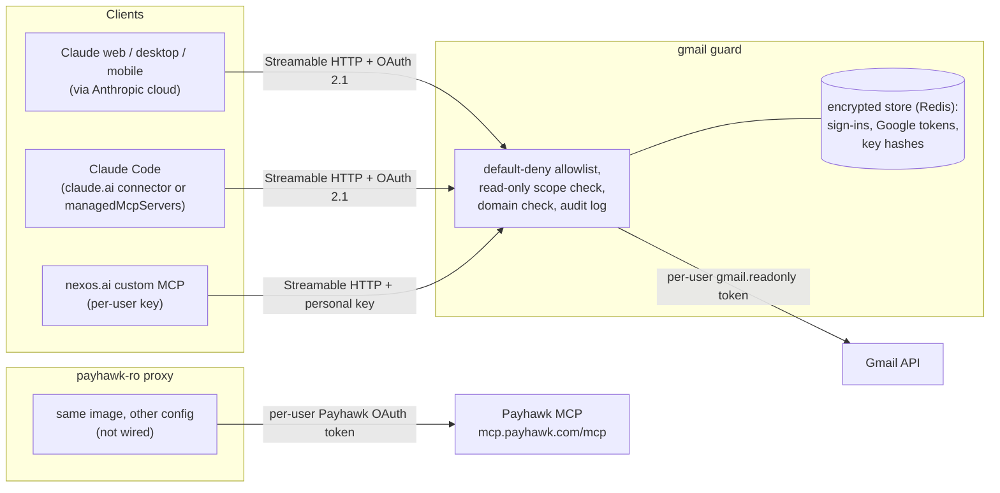
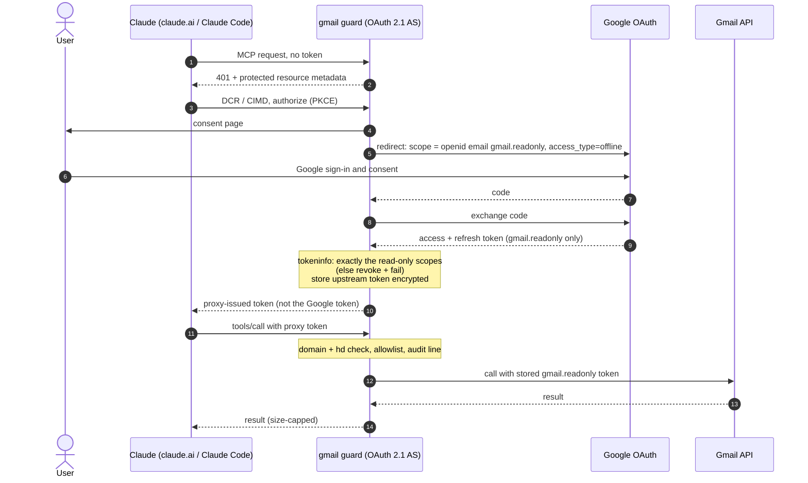
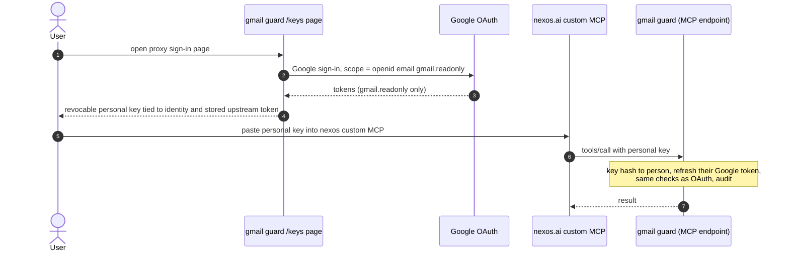
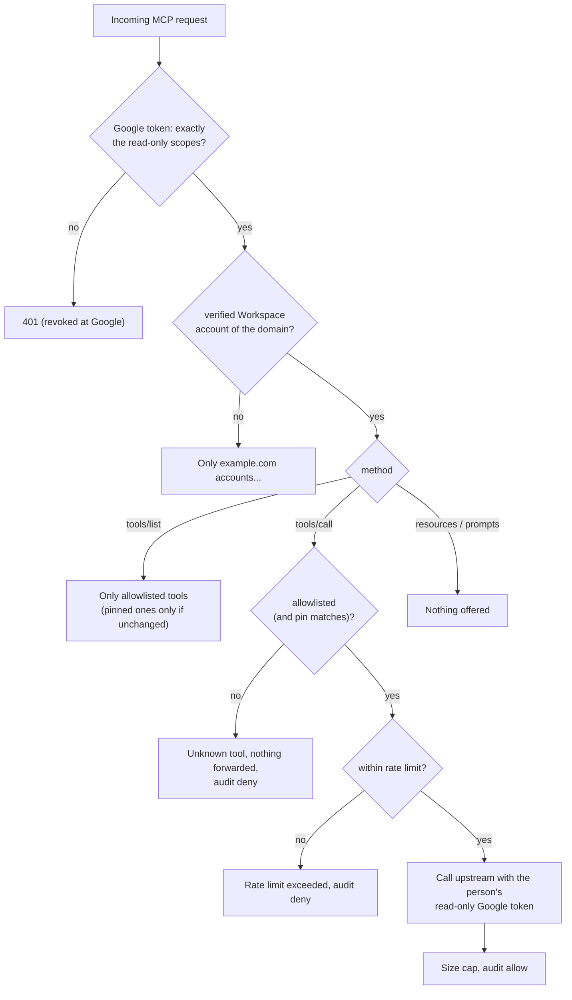

# Proxy design

> **Status: built as [MCP Guard](../README.md).** The guard in this repo follows this design: one FastMCP codebase, one deployment per upstream, Google sign-in for Claude (OAuth) and nexos.ai (personal keys), a default-deny allowlist, a Gmail upstream on the GA Gmail API by default and on Google's Gmail MCP by config. Payhawk wiring and any real deployment are still open (see [DEPLOY.md](../DEPLOY.md#open-items) and [open-questions.md](open-questions.md)). This page keeps the reasoning; where the build differs from the original proposal, it says so. Sources checked on 2026-11-08; evidence labels as in [findings.md](findings.md#scope).

## One generic proxy, one deployment per upstream

**Recommendation: one codebase, a generic default-deny allowlisting proxy with per-upstream config, deployed as one endpoint per upstream** (e.g. `gmail-guard.example.com/mcp`, `payhawk-guard.example.com/mcp`).

Why separate endpoints rather than one aggregated endpoint:

- Each Claude custom connector is one URL with one sign-in. Gmail needs Google sign-in; Payhawk needs a Payhawk sign-in. Splitting them keeps auth flows, OAuth clients, secrets and blast radius separate.
- Each can be enabled, blocked or audited on its own in Claude org settings, Claude Code allowlists and nexos.
- Aggregating would force one consent to cover several upstream identities and would merge tool namespaces.

Why one codebase rather than one bespoke server per upstream:

- The safety-critical parts (allowlist enforcement, schema pinning, audit, auth plumbing) are identical, and should be written and tested once.

There are two **upstream kinds** behind the same policy core:

1. **`mcp` upstream:** the proxy is an MCP client to an existing server (Payhawk MCP; Google Gmail MCP once acceptable). Tools are filtered and pinned.
2. **`gmail_api` upstream** (proposed as "native"): the guard implements read-only tools itself against the Gmail API with the person's `gmail.readonly` token: `search_threads`, `get_thread`, `get_message`, `list_labels`, `list_drafts`, `get_draft`, named like Gmail MCP's read-only tools.

### Gmail: Gmail API vs Google's Gmail MCP

For Gmail, **the Gmail API (`gmail_api`) is the default**:

- The Gmail API is GA, while Google's MCP is Developer Preview.
- We control the exact read surface.
- The token floor is the same.
- Switching to proxying Google's MCP later is a config change (`MCP_GUARD_UPSTREAM=gmail-mcp`; [README](../README.md#gmail-api-or-gmail-mcp)).

| | Gmail API (`gmail_api`) | Proxy Google's Gmail MCP |
|---|---|---|
| Upstream maturity | GA | Developer Preview, needs program enrollment ([Configure Gmail MCP](https://developers.google.com/workspace/gmail/api/guides/configure-mcp-server)) |
| Read surface | Exactly the six tools we implement | Upstream's tools, filtered by allowlist and optional pins |
| Token floor | `gmail.readonly` | `gmail.readonly` (if the OAuth client requests only that) |
| Kind | `gmail_api` | `mcp` |

### Payhawk

Payhawk would be an `mcp` upstream in front of `https://mcp.payhawk.com/mcp`, with the read allowlist from the [Payhawk tool classification](runbooks/payhawk.md#tool-classification-82-tools). Per-user Payhawk OAuth from the proxy is **blocked today** by Payhawk's redirect-URI allowlist and needs Payhawk Support to allow the proxy's redirect URI (see [upstream auth](#how-the-proxy-authenticates-upstream) and [runbooks/payhawk.md](runbooks/payhawk.md)). If only Claude needs Payhawk, no proxy is needed: add Payhawk directly as a custom connector and Block its write tools.

## Architecture



## Transport and hosting

- **Transport:** Streamable HTTP only. Claude custom connectors, Claude Code `--transport http` and nexos custom MCP all support it; nexos supports only that.
- **Reachability:** claude.ai custom connectors are called from Anthropic's cloud, so the proxy must be publicly reachable. Optionally firewall to Anthropic's IP ranges, plus nexos IPs (on request from nexos). Or keep it private behind Claude [MCP tunnels](https://claude.com/docs/connectors/mcp-tunnels/overview.md). nexos needs internet reachability either way.
- **Host:** any platform that runs a container behind HTTPS: the company platform that runs `internal-mcp`, Google Cloud Run, Kubernetes. What matters is that the Google OAuth client lives in a GCP project owned by the same Workspace org (that makes the Internal consent screen possible, so no restricted-scope verification), that secrets come from a secret store, and that more than one replica shares Redis for sign-ins ([DEPLOY.md](../DEPLOY.md#3-hosting)).

## How users authenticate to the proxy

- **Claude (web, desktop, Claude Code):** the proxy acts as an **OAuth 2.1 authorization server** for MCP clients (protected resource metadata, DCR and/or CIMD, PKCE, consent screen). It **issues its own tokens**. On Gmail, signing in to the proxy is the Google sign-in, requesting `openid email https://www.googleapis.com/auth/gmail.readonly`, with `access_type=offline` so a refresh token is returned. Google notes that without it users re-auth hourly. Reject accounts whose `hd` claim isn't your Workspace domain.
  - FastMCP's `OAuthProxy` / `GoogleProvider` implements exactly this "token factory" pattern. It issues its own JWTs, stores upstream tokens Fernet-encrypted, and shows a consent page against confused-deputy attacks ([OAuth Proxy](https://gofastmcp.com/docs/servers/auth/oauth-proxy.md), [Google](https://gofastmcp.com/docs/integrations/google.md)).
- **nexos.ai:** its custom MCP docs only mention per-user API keys, so the guard has a **personal key mode** (on with `MCP_GUARD_PERSONAL_KEYS=true`, alongside OAuth on the same deployment). A user signs in on the proxy's web page (same Google flow), gets a revocable personal key tied to their identity and stored upstream token, and pastes it into nexos. Ask nexos whether custom MCP supports OAuth first; if it does, skip this mode.
- **No token passthrough.** The MCP spec forbids it: "The MCP server MUST NOT pass through the token it received from the MCP client" ([authorization security](https://modelcontextprotocol.io/specification/2026-07-28/basic/authorization/security-considerations.md)). FastMCP proxies forward incoming headers (including `Authorization`) to HTTP backends **by default**. The guard sets `forward_incoming_headers=False` and sends only the person's Google token ([FastMCP proxy](https://gofastmcp.com/docs/servers/providers/proxy.md)).

### Auth flow: Claude to the Gmail proxy



### Auth flow: nexos personal key mode



## How the proxy authenticates upstream

| Upstream | Recommended | Alternative | Avoid |
|---|---|---|---|
| Gmail (`gmail_api` or Gmail MCP) | Per-user OAuth with **only `gmail.readonly`**, through the org's Internal OAuth client, restricted by the Google admin to Specific Google data = `gmail.readonly` + sign-in scopes [GWA] | DWD service account limited to `gmail.readonly` [GWA super admin]: no per-user consent, but impersonates anyone | Any broader scope |
| Payhawk MCP | Per-user OAuth: the proxy is an OAuth client to Payhawk's authorization server, and each user signs in with their Payhawk login, so Payhawk role scoping is kept. **Blocked today** by Payhawk's redirect-URI allowlist; needs **Payhawk Support to allow the proxy's redirect URI** | Payhawk Developer API with a **Read-only** API key and native read tools. This works today, but it is **one shared account-wide credential**: every user sees everything the key sees, losing per-user permissions. Not recommended for finance data | Passing the Claude-obtained Payhawk token through the proxy: forbidden by the MCP spec, and fragile because of token audience |
| Payhawk, Claude-only | **No proxy:** add Payhawk directly as a Claude custom connector and Block its write tools in the org policy (enforced server-side) | | |

## Policy core (default deny)

- **One `guard.yaml`** with one entry per upstream ([configuration.md](configuration.md)):

  ```yaml
  upstreams:
    gmail:
      kind: gmail_api
      url: https://gmail.googleapis.com
      google_scopes: [https://www.googleapis.com/auth/gmail.readonly]
      allow: [search_threads, get_thread, get_message, list_drafts, get_draft, list_labels]
  # anything not listed is denied
  ```

- **Listing and calling:** FastMCP's `Visibility` transforms hide everything, then show the allowlisted names. A hidden tool is left out of `tools/list` and refused on `tools/call` ("Unknown tool") without reaching the upstream, whether or not the client listed first.
- **Pins (optional, `mcp` upstreams):** a pinned tool whose definition hash (name, description, input schema) changes is dropped from listing and calling, with a warning carrying the new hash. The proposal made pins mandatory for every tool; the build keeps the draft's plain name allowlist and makes pins opt-in, because the default Gmail upstream is the guard's own code.
- **Read-only scope floor:** `google_scopes` must be `.readonly` scopes, and every token is checked against exactly those (plus sign-in scopes) on every request.
- **Annotations:** the guard passes upstream annotations through for `mcp` upstreams and sets `readOnlyHint` on its own Gmail tools; decisions never depend on them.
- **Other MCP features:** resources, prompts and resource templates are never offered.
- **Not built:** per-tool argument constraints (every allowed tool is read-only whatever its arguments) and prompt-injection screening of responses (Google requires screening such as Model Armor for its own Workspace MCP servers).
- **Response handling:** results over 1 MB are cut; Gmail bodies at 20,000 characters. A per-person rate limit protects the Gmail quota everyone shares.



## Logging and audit

- One JSON line per tool call, after it ran: `upstream`, `person` (email), `client` (`oauth` or `personal_key`), `tool`, `decision` (allow / deny), `outcome` (ok / error / refused / rate_limited), `duration_ms` ([format](configuration.md#audit-log)).
- No arguments, results or tokens. (The proposal had an argument hash; the build leaves arguments out entirely.)
- Ship logs to the platform's log store, then to a SIEM. Alert on `deny` with `refused` (an agent trying a tool it doesn't have) and on the pin-drift warning.
- Correlate with Google Workspace OAuth log events [GWA] and with the Claude Enterprise Compliance API if on Enterprise (not researched in depth).

## Wiring the proxy into each client and stopping the unrestricted path

| Step | Who |
|---|---|
| Create the GCP project in the org, Internal consent screen, Web OAuth client with the guard's callbacks (`https://gmail-guard.example.com/auth/callback`, plus `/keys/callback` for personal keys), scopes `openid email gmail.readonly` ([DEPLOY.md](../DEPLOY.md#1-google-oauth-client-needed-for-any-deployment)) | GCP project owner in the Workspace org (Internal audience needs the org-owned project) |
| Set the proxy's OAuth client in API controls to **Specific Google data** = `gmail.readonly` + sign-in scopes (or Trusted) | **[GWA]** |
| Set Anthropic's **"Claude for Gmail"** (and nexos's Gmail app) to **Blocked** | **[GWA]** |
| Optional: unconfigured third-party apps = "basic info only" or "don't allow"; Gmail service Restricted | **[GWA]**, with care: existing untrusted tokens are revoked |
| Claude: Organization settings > Connectors > Add > Custom > Web, proxy URL, "Sign in when needed", OAuth client "Use Claude's published identity" (CIMD, recommended) or "Register automatically" (DCR). Set every exposed tool to Always allow (they are all read) | Claude Owner |
| Claude: remove or don't enable the directory Gmail connector. Team: decline-and-block member requests for it. Enterprise: leave requests off and Block Gmail in every custom role | Claude Owner |
| Claude Enterprise: turn on Restrict verified-domain connectors | Claude Owner (or Identity & Access Manage) |
| Claude Code: server-managed settings (Team and Enterprise) **and** MDM `managed-settings.json` for API-key / nexos-gateway sessions | Claude Owner + IT |
| Claude Desktop: `isLocalDevMcpEnabled=false`, block desktop extensions or use the allowlist, `forceLoginOrgUUID` | IT (MDM); Enterprise can use Organization settings |
| nexos: Gmail integration **Inactive**; add the proxy as custom MCP (Streamable HTTP, personal-key auth) | nexos Owner |

The per-role runbooks: [Google Workspace admin](runbooks/google-workspace-admin.md), [Claude org](runbooks/claude-org.md#route-b-read-only-proxy-or-google-gmail-mcp-as-custom-connector), [Claude Code managed settings](runbooks/claude-code-managed-settings.md), [nexos](runbooks/nexos.md).

## Reuse an existing gateway or build?

| Option | Fit | Verdict |
|---|---|---|
| **FastMCP v4 (Python)**, PrefectHQ/fastmcp: 28.3k stars, v4.1.6 released 2026-11-03 | Proxy provider for upstream MCP; `enable(..., only=True)` **allowlist mode** ("A disabled tool disappears from listings and cannot be called") ([visibility](https://gofastmcp.com/docs/servers/visibility.md)); middleware for call-time checks; OAuthProxy + GoogleProvider (spec-shaped token factory, consent, encrypted token store); Streamable HTTP | **Build on it** (thin layer: config, pins, audit, personal keys) |
| **agentgateway** (Rust, Linux Foundation): 6k stars, v1.7 | `mcpAuthorization` CEL rules per tool (`mcp.tool.name`, `jwt.*`); unauthorized tools are filtered from lists; acts as a resource server against Keycloak / Auth0 / Okta / ... ([MCP authz](https://agentgateway.dev/docs/standalone/latest/configuration/security/mcp-authz/), [MCP authn](https://agentgateway.dev/docs/standalone/latest/configuration/security/mcp-authn/)) | Strong policy engine, but its documented backend auth is static or passthrough. No per-user upstream OAuth to Google or Payhawk was found. It would still need an auth component and a native Gmail server. Revisit if the team later wants one central gateway |
| **IBM ContextForge** (Python): 4.8k stars | Virtual servers bundling selected tools, RBAC, upstream OAuth (per secondhand sources). Large surface; described by a competitor as alpha/beta without official support | Heavy for two read-only proxies; not verified first-hand |
| **Cloudflare MCP server portals** (managed; docs updated 2026-11-05) | Portal behind Cloudflare Access; users sign in through your IdP. Per-tool on/off, and an **allowlist mode via API** (`default_disabled: true` + `updated_tools`); otherwise "new tools and prompts are automatically enabled". Per-user upstream OAuth with **your own OAuth client and an explicit Scope field** ("Require user auth"). Access request logs; optional Gateway HTTP logs and DLP. Claude Desktop/claude.ai setup documented (redirect `https://claude.ai/api/mcp/auth_callback`) ([MCP portals](https://developers.cloudflare.com/cloudflare-one/access-controls/ai-controls/mcp-portals/)) | **Best "buy" candidate.** Limits: it only fronts MCP servers, so Gmail would sit behind Google's Developer Preview Gmail MCP; no documented pinning of tool definitions (an allowlisted name whose schema changes stays exposed); nexos would need Access OAuth or a shared service token; Payhawk still needs its redirect allowlist to include Cloudflare's callback; adds Cloudflare to the data path; Zero Trust plan cost not checked |
| **Google Cloud IAM deny policy on MCP tools** (Google-side) | A deny policy on `tools.call` with the condition `mcp.googleapis.com/tool.isReadOnly == false`, set at organisation, folder or project level, refuses every tool Google doesn't mark read-only; but "When an MCP client calls `tools/list`, a list of all tools is returned, including read-write tools" ([prevent read-write tool use](https://docs.cloud.google.com/mcp/prevent-read-write-tool-use)). The page doesn't say whether Workspace MCP servers (Gmail) are covered | Only for the `gmail-mcp` upstream, and only as a second layer under the guard's allowlist and the read-only scope: it trusts Google's own read-only flags and doesn't hide write tools. Test it when switching to Gmail MCP |
| **Docker MCP Gateway** | `docker mcp gateway run --tools ...` filtering; geared to local / stdio use ([docs](https://docs.docker.com/reference/cli/docker/mcp/gateway/run/)) | Not a multi-user remote OAuth service |
| Commercial (Composio, Arcade, MintMCP, Portkey, ...) | Hosted tool catalogs and gateways | Not verified here; puts a third party in the Gmail data path |


*Source: [Cloudflare docs, MCP server portals](https://developers.cloudflare.com/cloudflare-one/access-controls/ai-controls/mcp-portals/), captured 2026-11-08. Yellow highlight added.*

**Build vs buy:** the research recommends building on FastMCP over a Cloudflare portal, for four reasons:

- A native Gmail adapter on the GA Gmail API avoids depending on a Developer Preview server.
- Schema pinning is fail-closed.
- nexos can use personal keys.
- No extra vendor sits in the email and finance data path.

If the team would rather run no code, a Cloudflare portal in front of Google's Gmail MCP and Payhawk MCP, with `default_disabled: true` and upstream scope `gmail.readonly`, is the credible alternative. Spike it in M0 before committing.

**Language and framework: Python 3.12+, FastMCP v4, uv, pydantic, httpx** (the Gmail API calls are a handful of GETs, so no Google client library).

- FastMCP already has, as maintained code, the hardest parts to get right: the MCP OAuth authorization-server bridge with its token-factory model and Google provider; proxying to upstream MCP; allowlist-mode visibility; middleware.
- Python has first-class Google API clients.
- Alternative: TypeScript with the official MCP SDK. That works too, but the OAuth AS bridge would be hand-built.

## Repo layout

```
mcp-readonly-proxies/
  README.md                 # the guard: tools, settings, local test mode, Gmail API or MCP; research overview
  DEPLOY.md                 # OAuth client, settings, hosting, connecting clients, checks, open items
  guard.yaml                # upstreams: gmail (gmail_api, default), gmail-mcp (mcp), Payhawk example
  Dockerfile                # build, test (must pass), non-root runtime: mcp-guard --port 3000
  src/mcp_guard/
    server.py               # create_guard: FastMCPProxy or own tools, Visibility allowlist, middleware
                            # (DomainCheck, Audit, rate limit, Pins, UpstreamCheck, size cap), /health, main
    config.py               # guard.yaml and MCP_GUARD_* settings, strict
    google.py               # GoogleSignIn (OAuthProxy to Google), ScopeLimitedTokenVerifier, domain check
    gmail_api.py            # the six read-only Gmail API tools
    personal_keys.py        # /keys page, key verifier, X-API-Key
    storage.py              # Redis / file / memory, Fernet-encrypted
  tests/                    # unit, Gmail API, Google, storage and end-to-end tests; fakes/ (Google, Gmail API,
                            # Gmail MCP, local launcher); fixtures/gmail_tools.json (Gmail MCP's tool list)
  docs/                     # research, runbooks, this design, configuration, security model
  .github/workflows/ci.yml  # ruff, pyright, pytest (with Redis), image build and smoke test
```

## Milestones

1. **M0, skeleton:** done.
2. **M1, policy core:** done (allowlist for list and call, optional pins, audit, size cap, rate limit).
3. **M2, Gmail read-only server:** done: Google sign-in for Claude with the exact scope set, `hd` check, encrypted shared store, six tools on the Gmail API, Gmail MCP selectable. Tried end to end with Claude Code against a fake Google.
4. **M3, deploy and pilot:** open. Google OAuth client [GWA]; deploy; Claude Owner adds the custom connector; test in claude.ai web, Desktop and Claude Code against real Google; confirm the built-in Gmail connector can't be connected.
5. **M4, Payhawk:** open. Needs Payhawk Support to allow the guard's redirect URI (external lead time) and per-person Payhawk sign-in in the `mcp` upstream; or a Claude-only org Blocked policy with no Payhawk proxy.
6. **M5, nexos and hardening:** personal keys and rate limits done; nexos pilot, alerting on deny and drift, and prompt-injection screening open.
