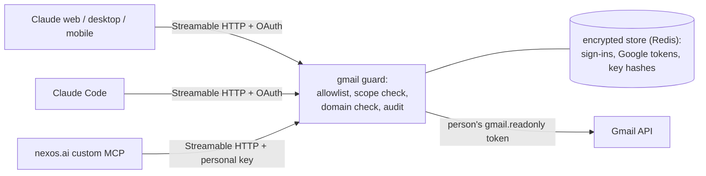
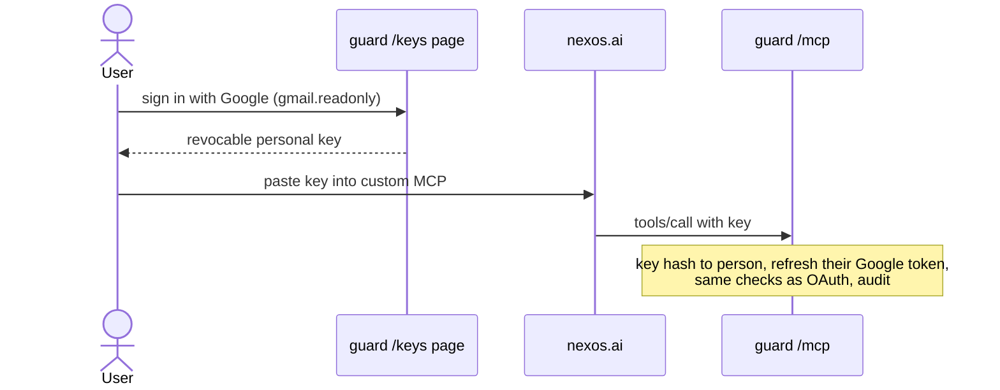
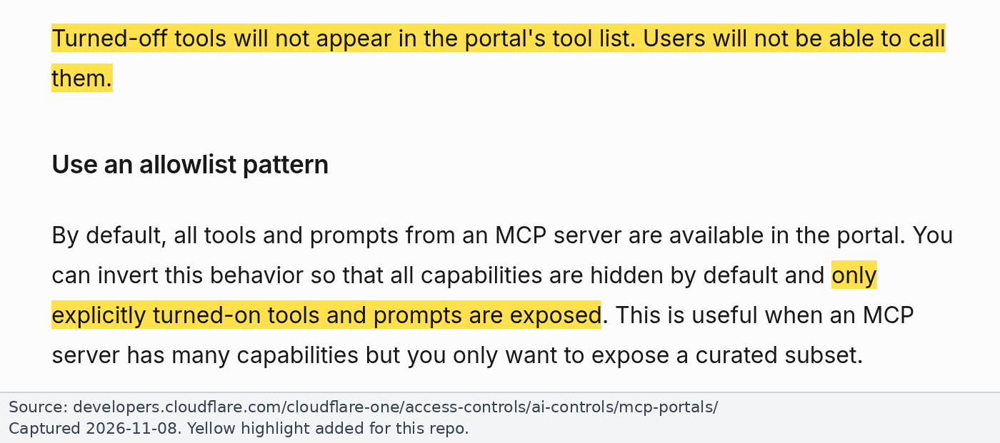

# Proxy design

This is the design of [MCP Guard](../README.md), the read-only proxy built in this repo, and the reasons behind it. Deployment and Payhawk are still open ([DEPLOY.md](../DEPLOY.md#open-items)). Research and evidence labels: [findings.md](findings.md). Sources checked on 2026-11-08.

## One generic proxy, one deployment per upstream

**One codebase:** a default-deny allowlisting proxy with per-upstream config. **One endpoint per upstream**, e.g. `gmail-guard.example.com/mcp` and later `payhawk-guard.example.com/mcp`.

- **Separate endpoints:** each Claude connector is one URL with one sign-in (Google for Gmail, Payhawk for Payhawk). Splitting keeps secrets and blast radius apart, and each can be enabled, blocked or audited on its own.
- **One codebase:** the safety-critical parts (allowlist, pins, audit, auth) are written and tested once.

Two upstream kinds share the same policy core:

1. **`gmail_api`** (default for Gmail): the guard's own six read-only tools on the GA Gmail API (`search_threads`, `get_thread`, `get_message`, `list_labels`, `list_drafts`, `get_draft`), named like Gmail MCP's.
2. **`mcp`**: the guard is an MCP client to an existing server (Google's Gmail MCP; Payhawk later) and filters its tools.

### Gmail: Gmail API vs Google's Gmail MCP

| | Gmail API (`gmail_api`, default) | Google's Gmail MCP (`mcp`) |
|---|---|---|
| Maturity | GA | Developer Preview, with extra Google setup ([findings 6.3](findings.md#63-googles-own-gmail-mcp-server-developer-preview)) |
| Read surface | Exactly our six tools | Upstream's tools, filtered by allowlist and optional pins |
| Token floor | `gmail.readonly` | `gmail.readonly` |

Switching is a config change (`MCP_GUARD_UPSTREAM=gmail-mcp`; [README](../README.md#gmail-api-or-gmail-mcp)).

### Payhawk

Payhawk would be an `mcp` upstream in front of `https://mcp.payhawk.com/mcp`, allowing the read tools from the [tool classification](runbooks/payhawk.md#tool-classification-82-tools). Not wired yet: an `mcp` upstream receives the person's Google token, while Payhawk needs its own per-person sign-in, which Payhawk [refuses](https://payhawk.com/help/troubleshooting-the-payhawk-mcp#sign-in-fails-host-not-allowed) until Support allowlists the guard's redirect URI ([upstream auth](#how-the-proxy-authenticates-upstream)). For Claude only, skip the proxy and Block Payhawk's write tools in Claude.

## Architecture



## Transport and hosting

- **Transport:** Streamable HTTP only. Claude, Claude Code and nexos all support it; [nexos supports nothing else](https://docs.nexos.ai/workspace/integrations/custom-mcp#:~:text=nexos.ai%20currently%20supports%20only%20streamable%20HTTP).
- **Reachability:** [claude.ai](https://support.claude.com/en/articles/11175166-get-started-with-custom-connectors-using-remote-mcp#h_b66e88c454) and [nexos](https://docs.nexos.ai/workspace/integrations/custom-mcp#:~:text=if%20you%20need%20to%20whitelist%20nexos.ai%20IPs) call it from their clouds, so it must be public (optionally firewalled to their IPs); Claude also offers [MCP tunnels](https://claude.com/docs/connectors/mcp-tunnels/overview).
- **Host:** any container platform behind HTTPS. The OAuth client must live in a GCP project owned by our Workspace org (Internal consent screen, so [no restricted-scope verification](https://support.google.com/cloud/answer/13464323#:~:text=Internal%20Use%20apps,configured%20for%20internal%20use)); secrets come from a secret store; replicas share Redis ([DEPLOY.md](../DEPLOY.md)).

## How users authenticate to the proxy

- **Claude (web, Desktop, Claude Code):** the guard is an **OAuth 2.1 authorization server** for MCP clients (CIMD and DCR, PKCE, consent page) and **issues its own tokens**. Use Claude's recommended ["Use Claude's published identity"](https://claude.com/docs/connectors/custom/add-unlisted#choose-authentication-settings) (CIMD); by default the guard accepts only Claude's callbacks. Signing in is the Google sign-in for `openid email gmail.readonly`, offline so a refresh token comes back. Only verified accounts of our Workspace domain (`hd` claim) get through. Built on FastMCP's [OAuthProxy](https://gofastmcp.com/docs/servers/auth/oauth-proxy#token-architecture) and [GoogleProvider](https://gofastmcp.com/docs/integrations/google): Google tokens are stored Fernet-encrypted, [never handed to the client](https://gofastmcp.com/docs/servers/auth/oauth-proxy#client-facing-mitigation).
- **nexos.ai:** its [custom MCP](https://docs.nexos.ai/workspace/integrations/custom-mcp#add-the-custom-mcp-to-nexos.ai) documents only per-user API keys, so the guard has a **personal key mode** (`MCP_GUARD_PERSONAL_KEYS=true`, next to OAuth). A user signs in with Google on the guard's `/keys` page and pastes the revocable key into nexos ([nexos-setup.md](nexos-setup.md)).
- **No token passthrough**, as the [MCP spec](https://modelcontextprotocol.io/specification/2026-07-28/basic/authorization/security-considerations#access-token-privilege-restriction) requires. FastMCP forwards incoming headers by default, so the guard sets `forward_incoming_headers=False` ([FastMCP proxy](https://gofastmcp.com/docs/servers/providers/proxy#http-header-forwarding)).

### Auth flow: nexos personal key mode



## How the proxy authenticates upstream

| Upstream | Recommended | Alternative | Avoid |
|---|---|---|---|
| Gmail | Per-user OAuth with **only `gmail.readonly`** via our Internal client, which the Google admin limits to that scope [GWA] | [Domain-wide delegation](https://knowledge.workspace.google.com/admin/apps/control-api-access-with-domain-wide-delegation#before-you-begin) limited to `gmail.readonly`; can impersonate anyone | Any broader scope |
| Payhawk MCP | Per-user OAuth with each person's Payhawk login, keeping Payhawk roles. **Blocked** until [Payhawk Support](https://payhawk.com/help/troubleshooting-the-payhawk-mcp#sign-in-fails-host-not-allowed) allows the guard's redirect URI | A **Read-only** [Developer API key](https://payhawk.com/help/overview-of-the-payhawk-developer-api#h_8996f3095d): works today, but one account-wide key, so everyone sees everything | Token passthrough |
| Payhawk, Claude only | **No proxy:** Payhawk as a Claude custom connector, write tools Blocked | | |

## Policy core (default deny)

- **`guard.yaml`** has one entry per upstream; anything not listed is denied ([configuration.md](configuration.md)):

  ```yaml
  upstreams:
    gmail:
      kind: gmail_api
      url: https://gmail.googleapis.com
      google_scopes: [https://www.googleapis.com/auth/gmail.readonly]
      allow: [search_threads, get_thread, get_message, list_drafts, get_draft, list_labels]
  ```

- **Listing and calling:** other tools are missing from `tools/list` and refused on `tools/call` ("Unknown tool") without reaching the upstream.
- **Pins (optional, `mcp` only):** a pinned tool whose definition hash (name, description, input schema) changes is dropped, with one warning. Our own Gmail API tools need no pins.
- **Scope floor:** `google_scopes` must be `.readonly`, and each Google token must hold exactly those plus sign-in scopes. A broader token is revoked and refused.
- **Annotations** never decide anything. **Resources and prompts** are never offered.
- **Limits:** results capped at 1 MB (Gmail bodies returned 20,000 characters at a time, attachment contents never read); a per-person rate limit; Gmail rate limits retried briefly.
- **Not built:** argument checks (every allowed tool is read-only whatever its arguments) and prompt-injection screening of results.

## Logging and audit

- One JSON line per tool call: `upstream`, `person`, `client` (`oauth`, `personal_key`, or `dev` in local test mode), `tool`, `decision`, `outcome`, `duration_ms` ([format](configuration.md#audit-log)).
- No arguments, results or tokens are logged.
- Ship to a SIEM; alert on `refused` (an agent trying a tool it doesn't have) and on pin drift. Correlate with Google OAuth log events [GWA].

## Wiring the proxy into each client

A GCP project owner creates the Internal OAuth client ([DEPLOY.md](../DEPLOY.md)); a Google admin limits it to `gmail.readonly` and blocks "Claude for Gmail" and nexos's Gmail app [GWA]; a Claude Owner adds the guard as a custom connector and keeps the built-in Gmail connector off; IT deploys Claude Code and Desktop managed settings; a nexos Owner sets Gmail Inactive and adds the guard. Runbooks: [Google Workspace admin](runbooks/google-workspace-admin.md), [Claude org](runbooks/claude-org.md), [Claude Code managed settings](runbooks/claude-code-managed-settings.md), [nexos](nexos-setup.md).

## Reuse an existing gateway or build?

| Option | Fit | Verdict |
|---|---|---|
| **FastMCP v4** (Python, [28.3k stars](https://github.com/PrefectHQ/fastmcp)) | Upstream MCP proxy; [allowlist mode](https://gofastmcp.com/docs/servers/visibility#allowlist-mode) ("A disabled tool disappears from listings and cannot be called", [visibility](https://gofastmcp.com/docs/servers/visibility#component-visibility)); middleware; OAuthProxy + GoogleProvider | **Built on it** (thin layer: config, pins, audit, personal keys) |
| **agentgateway** (Rust) | Per-tool CEL rules ([MCP authz](https://agentgateway.dev/docs/standalone/latest/documentation/configuration/security/mcp-authz/#role-based-access-with-jwt-claims)); no per-user upstream OAuth found | Would still need an auth component and a Gmail server |
| **IBM ContextForge** (Python) | Virtual servers, RBAC, upstream OAuth (secondhand sources) | Heavy for two proxies; not verified first-hand |
| **Cloudflare MCP server portals** (managed) | Behind Cloudflare Access. [Allowlist mode via API](https://developers.cloudflare.com/cloudflare-one/access-controls/ai-controls/mcp-portals/#use-an-allowlist-pattern) (`default_disabled: true`), otherwise ["new tools and prompts are automatically enabled"](https://developers.cloudflare.com/cloudflare-one/access-controls/ai-controls/mcp-portals/#synchronize-the-mcp-server). Per-user upstream OAuth with your own client and scopes ([MCP portals](https://developers.cloudflare.com/cloudflare-one/access-controls/ai-controls/mcp-portals/#configure-manual-oauth-credentials)) | **Best "buy" option.** But Gmail would rely on the Developer Preview Gmail MCP; no pinning; nexos would need a shared token; Payhawk still needs its redirect allowlist; another vendor in the data path |
| **Google Cloud IAM deny policy** on MCP tools | Denies `tools.call` where `mcp.googleapis.com/tool.isReadOnly == false` (org, folder or project; [apply](https://docs.cloud.google.com/mcp/prevent-read-write-tool-use#apply-deny-policy)), but "a list of all tools is returned, including read-write tools" ([prevent read-write tool use](https://docs.cloud.google.com/mcp/prevent-read-write-tool-use#prevent-read-write-tool-use)). Workspace (Gmail) coverage not stated | Only for the `gmail-mcp` upstream, as a second layer: it trusts Google's read-only flags and doesn't hide write tools. Test when switching |
| **Docker MCP Gateway** | Local tool filtering ([docs](https://docs.docker.com/reference/cli/docker/mcp/gateway/run/#options)) | Not multi-user |
| Commercial (Composio, Arcade, Portkey, ...) | Hosted gateways | Not verified; a third party in the data path |



*Source: [Cloudflare docs, MCP server portals](https://developers.cloudflare.com/cloudflare-one/access-controls/ai-controls/mcp-portals/#turn-off-individual-tools-or-prompts), 2026-11-08, highlight added.*

**Why FastMCP over a Cloudflare portal:** the GA Gmail API, fail-closed pinning, personal keys for nexos, and no extra vendor in the data path. To run no code, a Cloudflare portal in front of Google's Gmail MCP with `default_disabled: true` and scope `gmail.readonly` is the credible alternative.

**Stack:** Python 3.12+, FastMCP v4, uv, pydantic, httpx (no Google client library; the Gmail calls are a few GETs). FastMCP maintains the hardest parts: the OAuth bridge, proxying and allowlist visibility. TypeScript would need a hand-built OAuth bridge.
