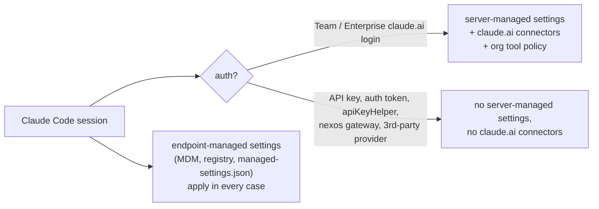
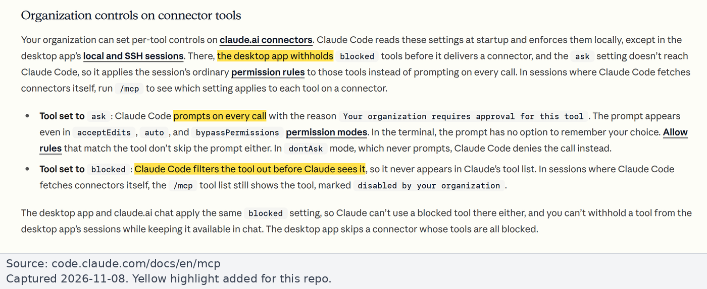
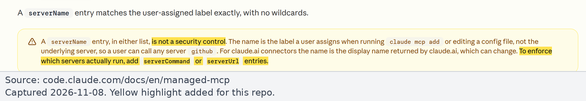

# Runbook: Claude Code managed settings

For IT and Claude Owners. Locks Claude Code to approved MCP servers and denies Gmail write tools, independently of the claude.ai org tool policy. Background: [findings.md](../findings.md#42-claude-code). All facts and examples are from the cited Claude Code docs, checked on 2026-11-08.

> **Screenshots:** these are configuration files, so there is no console to show. The images below show the cited Claude Code docs text.

## Which sessions each delivery method reaches

Claude Code gets claude.ai connectors and **server-managed settings** only when it is signed in with a Team or Enterprise claude.ai login. Sessions on `ANTHROPIC_API_KEY`, `ANTHROPIC_AUTH_TOKEN`, `apiKeyHelper` or a third-party provider get neither ([mcp.md](https://code.claude.com/docs/en/mcp.md#use-mcp-servers-from-claude-ai), [server-managed-settings.md](https://code.claude.com/docs/en/server-managed-settings.md)). That includes Claude Code run through the nexos.ai gateway (`ANTHROPIC_BASE_URL=https://api.nexos.ai` + `ANTHROPIC_AUTH_TOKEN`, [nexos Claude Code integration](https://docs.nexos.ai/gateway-api/integrations/claude-code.md)).



| Delivery | Who sets it | Notes |
|---|---|---|
| **Server-managed** | Team and Enterprise Owners | Fetched at startup, refreshed hourly. Only reaches sessions with a Team or Enterprise login |
| **Endpoint-managed** (MDM, registry, `managed-settings.json`) | IT | "Endpoint-managed settings provide stronger security guarantees" ([server-managed-settings.md](https://code.claude.com/docs/en/server-managed-settings.md)). Needed for API-key and nexos-gateway sessions |

Use **both**: server-managed for logged-in sessions, plus MDM / file for everything else. Without MDM, a member can escape server-managed controls by switching auth to an API key or gateway.

File locations for `managed-settings.json` ([managed-settings.md](https://code.claude.com/docs/en/managed-settings.md)):

- macOS: `/Library/Application Support/ClaudeCode/managed-settings.json`
- Linux and WSL: `/etc/claude-code/managed-settings.json`
- Windows: `C:\Program Files\ClaudeCode\managed-settings.json`

## Controls

| Control | What it does | Key facts |
|---|---|---|
| Org connector tool policy | `blocked` tools are filtered out; an `ask` tool prompts on every call even in `bypassPermissions` | Set in claude.ai, not here ([claude-org.md](claude-org.md)). Desktop local and SSH sessions get only `blocked` ([mcp.md](https://code.claude.com/docs/en/mcp.md#organization-controls-on-connector-tools)) |
| Permission deny rules | `"deny": ["mcp__claude_ai_Gmail__send_message", ...]` or `"mcp__claude_ai_Gmail__*"`. A deny rule from any level wins; managed rules can't be overridden, not even by `--allowedTools` | `allowManagedPermissionRulesOnly` makes managed settings the only source of rules. `mcp__` rules with parentheses are skipped in settings files ([permissions.md](https://code.claude.com/docs/en/permissions.md)) |
| MCP allowlist / denylist | `allowManagedMcpServersOnly: true` + `allowedMcpServers` (only these load); `deniedMcpServers` | `serverName` is "not a security control"; prefer `serverUrl`. The denylist always wins ([managed-mcp.md](https://code.claude.com/docs/en/managed-mcp.md)) |
| Exclusive set | `managed-mcp.json` loads only listed servers and suppresses claude.ai connectors unless `allowAllClaudeAiMcps: true` | File only (MDM); can't be delivered server-side |
| Provide a server to all | `managedMcpServers: { "gmail-guard": { "type": "http", "url": "..." } }` | v2.1.259+; skips the allowlist check |
| Pin OAuth scopes for user-added servers | `"oauth": { "scopes": "https://www.googleapis.com/auth/gmail.readonly" }` | Overrides scopes the server advertises ([mcp.md](https://code.claude.com/docs/en/mcp.md#restrict-oauth-scopes)) |
| Hooks | A `PreToolUse` hook can deny any call; deny rules hold even if a hook says allow; `allowManagedHooksOnly` restricts hooks to managed ones | [permissions.md](https://code.claude.com/docs/en/permissions.md#extend-permissions-with-hooks) |
| Disable claude.ai connectors | `disableClaudeAiConnectors: true` (any source set to true wins) | Fetched connectors only |



*Source: [Claude Code docs, MCP](https://code.claude.com/docs/en/mcp.md#organization-controls-on-connector-tools), captured 2026-11-08. Yellow highlight added.*



*Source: [Claude Code docs, Managed MCP configuration](https://code.claude.com/docs/en/managed-mcp.md), captured 2026-11-08. Yellow highlight added.*

## Example: proxy route

Only the read-only proxies load; the built-in Gmail connector, Google's Gmail MCP and the direct Payhawk MCP are denied; Gmail write tools are denied by name from any server.

```json
{
  "allowManagedMcpServersOnly": true,
  "allowedMcpServers": [
    { "serverUrl": "https://gmail-guard.example.com/*" },
    { "serverUrl": "https://payhawk-ro.example.com/*" }
  ],
  "deniedMcpServers": [
    { "serverName": "claude.ai Gmail" },
    { "serverUrl": "https://gmailmcp.googleapis.com/*" },
    { "serverUrl": "https://mcp.payhawk.com/*" }
  ],
  "allowManagedPermissionRulesOnly": true,
  "permissions": {
    "deny": [
      "mcp__*__send_message", "mcp__*__reply", "mcp__*__forward",
      "mcp__*__create_draft", "mcp__*__update_draft",
      "mcp__*__trash_message", "mcp__*__trash_thread"
    ]
  }
}
```

Notes, checked against [managed-mcp.md](https://code.claude.com/docs/en/managed-mcp.md) and [permissions.md](https://code.claude.com/docs/en/permissions.md):

- `allowManagedMcpServersOnly` must sit next to `allowedMcpServers` in a managed source; otherwise allowlists merge from every scope, including a user's own `~/.claude/settings.json`. It is separate from `allowManagedPermissionRulesOnly`, which locks down permission rules only.
- In `deniedMcpServers`, `serverName` accepts a claude.ai connector's display name (the docs' example is `{ "serverName": "claude.ai Slack" }`). The display name can change, so prefer a `serverUrl` entry where possible. In `allowedMcpServers`, `serverName` allows only letters, numbers, hyphens and underscores; use `serverUrl` to allowlist a claude.ai connector.
- The `allowedMcpServers` URLs must also admit the claude.ai-fetched custom connector. A `serverUrl` entry matching the proxy URL does that, since fetched connectors are checked by URL.
- Deny rules accept globs in the tool-name position, so `mcp__*__send_message` matches across servers. This matters because in Claude Desktop's Code tab, local sessions mount claude.ai connectors under connection UUIDs (`mcp__<uuid>__send_message`), and rules written as `mcp__claude_ai_Gmail__*` silently don't match there (**Community**, [#92787](https://github.com/anthropics/claude-code/issues/92787), open). The glob loses per-connector precision. **The org `blocked` policy is the reliable control for Desktop sessions.**

## Example: built-in route, defence in depth

If the built-in Gmail connector stays enabled with write tools Blocked in claude.ai, add managed deny rules as a second layer:

```json
{
  "allowManagedPermissionRulesOnly": true,
  "permissions": {
    "deny": [
      "mcp__claude_ai_Gmail__send_message",
      "mcp__claude_ai_Gmail__reply",
      "mcp__claude_ai_Gmail__forward",
      "mcp__claude_ai_Gmail__create_draft",
      "mcp__claude_ai_Gmail__update_draft",
      "mcp__claude_ai_Gmail__trash_message",
      "mcp__claude_ai_Gmail__trash_thread",
      "mcp__*__send_message", "mcp__*__reply", "mcp__*__forward"
    ]
  }
}
```

Tools from connectors Claude Code fetches itself appear as `mcp__claude_ai_<server>__<tool>` ([permissions.md](https://code.claude.com/docs/en/permissions.md)). The tool names are community-observed (Anthropic publishes no tool list); see [findings 3.1](../findings.md#31-what-the-connector-exposes).

## Example: provide the proxy to every user

```json
{
  "managedMcpServers": {
    "gmail-guard": {
      "type": "http",
      "url": "https://gmail-guard.example.com/mcp"
    }
  }
}
```

Requires Claude Code v2.1.259 or later. The `url` must be `https://`, and entries may not contain `command`, `args`, `env`, `headersHelper` or `${VAR}` references ([managed-mcp.md](https://code.claude.com/docs/en/managed-mcp.md)). Claude Desktop has a managed setting with the same name but a different shape; don't copy one into the other.

For a user-added OAuth server, `oauth.scopes` pins the requested scopes (single space-separated string), as in the docs' `.mcp.json` example:

```json
{
  "mcpServers": {
    "gmail-guard": {
      "type": "http",
      "url": "https://gmail-guard.example.com/mcp",
      "oauth": {
        "scopes": "https://www.googleapis.com/auth/gmail.readonly"
      }
    }
  }
}
```

## Example: managed PreToolUse hook

A hook that denies write-shaped MCP tool names from any server, with `allowManagedHooksOnly` so users can't add their own hooks. The matcher is a regex over the tool name ([hooks.md](https://code.claude.com/docs/en/hooks.md)); the command prints the documented `PreToolUse` deny decision.

```json
{
  "allowManagedHooksOnly": true,
  "hooks": {
    "PreToolUse": [
      {
        "matcher": "mcp__.*__(send|reply|forward|create_draft|update_draft|trash|mark_.*_spam|label|unlabel|create_label|update_label|delete_label).*",
        "hooks": [
          {
            "type": "command",
            "command": "echo '{\"hookSpecificOutput\":{\"hookEventName\":\"PreToolUse\",\"permissionDecision\":\"deny\",\"permissionDecisionReason\":\"MCP write tools are blocked by organization policy\"}}'"
          }
        ]
      }
    ]
  }
}
```

PreToolUse hook decisions don't bypass permission rules: deny rules still apply even when a hook returns `"allow"` ([permissions.md](https://code.claude.com/docs/en/permissions.md#extend-permissions-with-hooks)). The hook is a backstop for names the deny list doesn't cover; the deny rules and the org Blocked policy remain the primary controls.

## Verify

The research recommends testing with `/mcp` and `claude doctor`. Expected behavior per [managed-mcp.md](https://code.claude.com/docs/en/managed-mcp.md):

- `/mcp` and `claude mcp list`: a server blocked by policy does not appear.
- `claude doctor`: shows resolved settings and lists skipped rules (e.g. `mcp__` rules with parentheses, [permissions.md](https://code.claude.com/docs/en/permissions.md)).
- `claude mcp add` with a URL not on the allowlist fails with `Cannot add MCP server "<name>": not allowed by enterprise policy`; one on the denylist fails with `... server is explicitly blocked by enterprise policy`.
