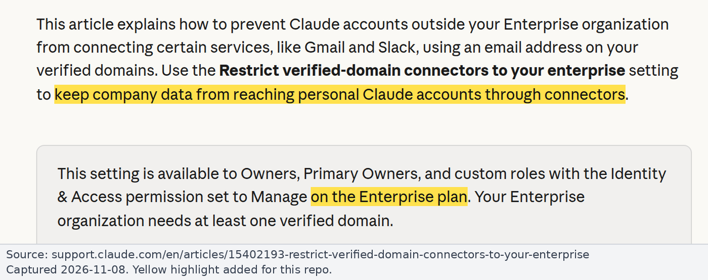
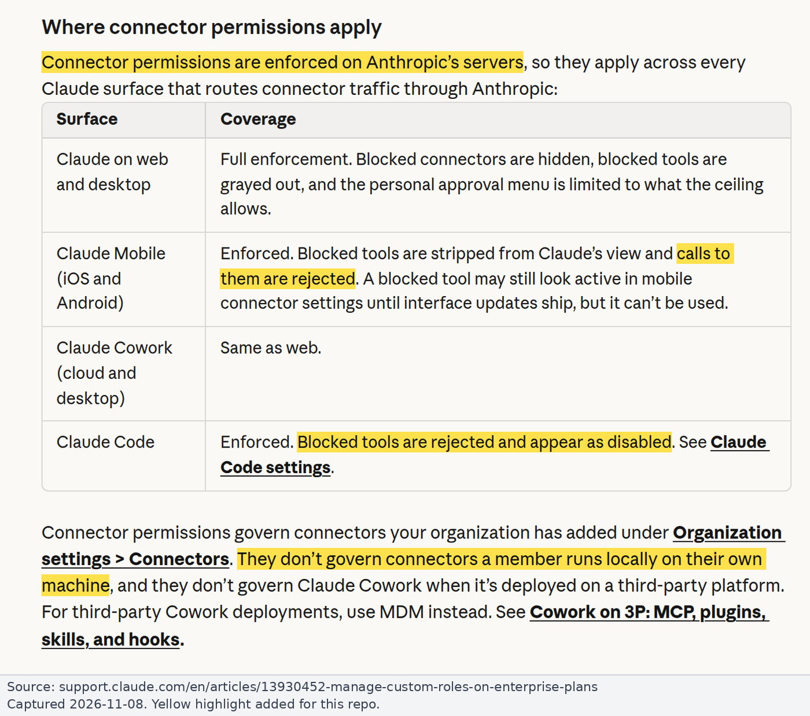

# Runbook: Claude Owner steps (Team and Enterprise)

For Claude organization Owners. Covers the built-in Gmail connector's tool policy, custom connectors, the verified-domain restriction and custom roles. Background: [findings.md](../findings.md#3-can-the-built-in-gmail-connector-be-restricted-to-read-only). Sources checked on 2026-11-08.

> **Screenshots:** the Anthropic help articles have no screenshots of Organization settings or the Tool permissions screen, and we have no Owner console access, so every step here is text only. The images below show the help-article text each step relies on.

Our plan is believed to be **Team** (from the onboarding email), pending confirmation.

**Team-plan gap:** on Team there is no verified-domain restriction, so a member's personal Claude account can connect work Gmail outside the org policy. Closing that requires the Google Workspace admin to block "Claude for Gmail" at Google [GWA] ([google-workspace-admin.md](google-workspace-admin.md#2-set-the-access-level-for-claude-for-gmail)), with Gmail then reached only through the read-only proxy added by an Owner as a custom connector.

## What the controls do

| Control | Team | Enterprise | Notes |
|---|---|---|---|
| Enable or remove a connector for the org (Organization settings > Connectors) | Yes | Yes | Members still sign in to Google individually ([11176164](https://support.claude.com/en/articles/11176164-use-connectors-to-extend-claude-s-capabilities)) |
| **Org-wide tool policy per tool or per group: Always allow / Needs approval / Blocked** | **Yes** | **Yes** | "This applies org-wide to everyone using the connector - individual users can't override it." ([11176164](https://support.claude.com/en/articles/11176164-use-connectors-to-extend-claude-s-capabilities)) |
| Per-role connector and tool grants (custom roles) | No | **Yes** | Grants add up across roles; the org policy is the ceiling; "Blocked: The connector or tool is hidden. Claude can't see it or call it." ([13930452](https://support.claude.com/en/articles/13930452-manage-custom-roles-on-enterprise-plans)) |
| Restrict verified-domain connectors | No | **Yes** | Gmail is on the supported list; not retroactive; fails open when identity can't be checked ([15402193](https://support.claude.com/en/articles/15402193-restrict-verified-domain-connectors-to-your-enterprise)) |
| Member connector requests | On by default | Off by default | An Owner can "Decline it and block the connector" ([11176164](https://support.claude.com/en/articles/11176164-use-connectors-to-extend-claude-s-capabilities)) |
| Who can add custom connectors | Owners, Primary Owners | Owners, Primary Owners, custom roles with Libraries "Manage" | [11175166](https://support.claude.com/en/articles/11175166-get-started-with-custom-connectors-using-remote-mcp) |

*Source: [Anthropic Help Center, Use connectors to extend Claude's capabilities](https://support.claude.com/en/articles/11176164-use-connectors-to-extend-claude-s-capabilities), captured 2026-11-08. Yellow highlight added.*

*Source: [Anthropic Help Center, Restrict verified-domain connectors to your Enterprise](https://support.claude.com/en/articles/15402193-restrict-verified-domain-connectors-to-your-enterprise), captured 2026-11-08. Yellow highlight added.*

**Where the tool policy is enforced** (Verified, [13930452](https://support.claude.com/en/articles/13930452-manage-custom-roles-on-enterprise-plans)): "Connector permissions are enforced on Anthropic's servers." Web and desktop full; mobile "calls to them are rejected"; Cowork same as web; Claude Code "Blocked tools are rejected and appear as disabled". "Access fails toward denying, never toward granting." Not covered: locally run connectors, Cowork on third-party platforms.

*Source: [Anthropic Help Center, Manage custom roles on Enterprise plans](https://support.claude.com/en/articles/13930452-manage-custom-roles-on-enterprise-plans), captured 2026-11-08. Yellow highlight added.*

**Always use Blocked, not Needs approval, for write tools:**

- Research mode: "Claude can invoke tools from your connectors automatically without further approval" ([11175166](https://support.claude.com/en/articles/11175166-get-started-with-custom-connectors-using-remote-mcp)).
- An org `ask` is not delivered to Claude Desktop's local and SSH Code sessions; only `blocked` is reliable there ([mcp.md](https://code.claude.com/docs/en/mcp.md#organization-controls-on-connector-tools)).
- Community reports say approvals were not shown in Claude Code ([#89304](https://github.com/anthropics/claude-code/issues/89304)).

## Route A: built-in Gmail connector with write tools Blocked

Anthropic-enforced read-only. The Google token still holds send permission (see [residual risks](../findings.md#83-residual-risks-of-82-why-81-is-the-guarantee)).

1. Organization settings > Connectors > Browse connectors > Gmail > "Add to your team".
2. Open the Gmail connector's **Tool permissions**.
   - Set the **write/delete group** to **Blocked**.
   - Also set every send, reply, forward, draft, trash, spam and label tool to **Blocked**. Community-observed names: `send_message`, `reply`, `forward`, `create_draft`, `update_draft`, `trash_message`, `trash_thread`, `mark_message_spam`, `mark_thread_spam`, `label_message`, `label_thread`, `unlabel_message`, `unlabel_thread`, `create_label`, `update_label`, `delete_label`.
   - Set read tools to Always allow or Needs approval.
   - The help article gives the path as "Customize > Connectors > select the connector > Tool permissions". The custom-roles article calls the same thing the per-connector policy "under Organization settings > Connectors".
3. **Enterprise only:**
   - Turn on Organization settings > Organization and access > **Restrict verified-domain connectors to your enterprise**.
   - Optionally use custom roles to grant Gmail only to some groups.
4. **Claude Code:** nothing extra is needed for `blocked` to apply. For defence in depth, add managed deny rules ([claude-code-managed-settings.md](claude-code-managed-settings.md)).
5. **[GWA]** Ask the Workspace admins to record "Claude for Gmail"'s scopes and set it to Trusted for the OUs that should use it ([google-workspace-admin.md](google-workspace-admin.md#2-set-the-access-level-for-claude-for-gmail)).
6. **Re-check regularly.** The docs don't say what default a newly added tool gets, and the connector has gained write tools over time. A group-level Blocked presumably catches new write tools, but that is **Inferred**. Re-check the tool list after Anthropic release notes, and review individual tools once (the read / write grouping is presumably driven by MCP annotations).

## Route B: read-only proxy or Google Gmail MCP as custom connector

Credential-level read-only. Needs the guard deployed ([DEPLOY.md](../../DEPLOY.md); Claude signs in to it with OAuth) or Google's Gmail MCP set up.

1. **Add the custom connector:** Organization settings > Connectors > Add > Custom > Web.
   - URL: the guard's URL (e.g. `https://gmail-guard.example.com/mcp`), or for Google's server `https://gmailmcp.googleapis.com/mcp/v1` with client ID and secret under Advanced.
   - Sign-in: "Sign in when needed".
   - OAuth client: "Register automatically" (DCR) or "Use your own OAuth client".
   - The OAuth callback is `https://claude.ai/api/mcp/auth_callback`.
   - The server must be publicly reachable from Anthropic's cloud, or exposed through [MCP tunnels](https://claude.com/docs/connectors/mcp-tunnels/overview.md).
2. **Tool policy:** the org tool policy covers custom connectors too ("Connector permissions govern connectors your organization has added under Organization settings > Connectors", [13930452](https://support.claude.com/en/articles/13930452-manage-custom-roles-on-enterprise-plans)).
   - Proxy: set every exposed tool to Always allow (they are all read).
   - Google Gmail MCP: set `create_draft`, `label_message`, `label_thread`, `unlabel_message`, `unlabel_thread`, `create_label` to **Blocked** as a second layer.
3. **Stop the unrestricted path:**
   - Remove, or don't enable, the directory Gmail connector.
   - Team: decline-and-block member requests for it.
   - Enterprise: leave member requests off and Block Gmail in every custom role.
4. **Enterprise:** turn on Restrict verified-domain connectors (Owner, or Identity & Access Manage).
5. **Claude Code and Desktop:** see [claude-code-managed-settings.md](claude-code-managed-settings.md) and the Desktop policies below.
6. **[GWA]** Ask the Workspace admins to Block "Claude for Gmail" and configure the read-only OAuth client as Specific Google data ([google-workspace-admin.md](google-workspace-admin.md)).

## Claude Desktop managed policies

Verified ([12622667](https://support.claude.com/en/articles/12622667-enterprise-configuration-for-claude-desktop), [10949351](https://support.claude.com/en/articles/10949351-getting-started-with-local-mcp-servers-on-claude-desktop)):

| Policy | Effect |
|---|---|
| `isLocalDevMcpEnabled=false` | Local MCP servers that users add in `claude_desktop_config.json` don't start |
| `isDesktopExtensionEnabled=false`, `isDesktopExtensionDirectoryEnabled=false` | Extensions and their directory are off. Team and Enterprise Owners can also run an extension allowlist |
| `forceLoginOrgUUID` | Pins the app to your org, so a personal account can't be used in the managed app |

- On **Enterprise** these can also be set in Organization settings > Plugins > Connectors ("Allow local MCP servers", "Block all desktop extensions"). On **Team** they need MDM.
- Remote connectors in Desktop are brokered through claude.ai, so the org tool policy applies to them.

## Personal accounts

Nothing in Claude org settings governs a member's personal Claude account.

- **Enterprise:** the verified-domain restriction closes this for Gmail.
- **Team:** no equivalent. Only the Google admin blocking "Claude for Gmail" closes it [GWA], and that also blocks the org's own use of the built-in connector.

## Payhawk

See [payhawk.md](payhawk.md). The same tool policy can Block Payhawk's write tools when the official Payhawk MCP is added as a custom connector.
