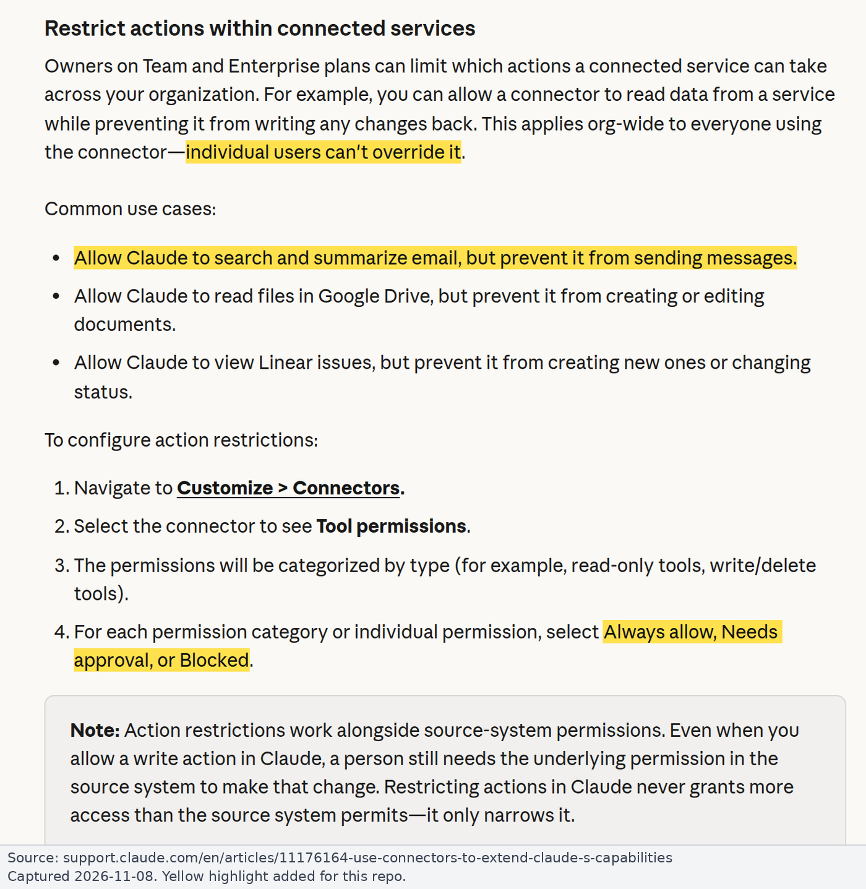

# Runbook: Claude Owner steps (Team and Enterprise)

For Claude organization Owners: make Gmail read-only in Claude. Background: [findings.md](../findings.md#3-can-the-built-in-gmail-connector-be-restricted-to-read-only). Sources checked on 2026-11-08; we have no Owner console access, so steps are text only. Our plan is believed to be **Team** (unconfirmed).

## What the controls do

| Control | Team | Enterprise | Notes |
|---|---|---|---|
| Enable or remove a connector (Organization settings > Connectors) | Yes | Yes | Members still [sign in to Google themselves](https://support.claude.com/en/articles/11176164-use-connectors-to-extend-claude-s-capabilities#h_b6f69dbd72) |
| **Tool policy per tool or group: Always allow / Needs approval / Blocked** | **Yes** | **Yes** | Org-wide; "individual users can't override it" ([11176164](https://support.claude.com/en/articles/11176164-use-connectors-to-extend-claude-s-capabilities#h_9fa8289074)) |
| Custom roles (per-role connector and tool grants) | No | **Yes** | Org policy is the ceiling ([13930452](https://support.claude.com/en/articles/13930452-manage-custom-roles-on-enterprise-plans#h_554f24644e)) |
| Restrict verified-domain connectors | No | **Yes** | Covers Gmail; [not retroactive](https://support.claude.com/en/articles/15402193-restrict-verified-domain-connectors-to-your-enterprise#h_077f0599f4); [fails open](https://support.claude.com/en/articles/15402193-restrict-verified-domain-connectors-to-your-enterprise#h_5f0f4c7960) if identity can't be checked ([15402193](https://support.claude.com/en/articles/15402193-restrict-verified-domain-connectors-to-your-enterprise#h_154f8902a3)) |
| Member connector requests | On by default | Off by default | Owner can "Decline it and block the connector" ([11176164](https://support.claude.com/en/articles/11176164-use-connectors-to-extend-claude-s-capabilities#h_9213598058)) |
| Who adds custom connectors | Owners | Owners, custom roles with Libraries "Manage" | [11175166](https://support.claude.com/en/articles/11175166-get-started-with-custom-connectors-using-remote-mcp#h_3d1a65aded) |

*Source: [Anthropic Help Center](https://support.claude.com/en/articles/11176164-use-connectors-to-extend-claude-s-capabilities#h_9fa8289074), captured 2026-11-08.*

Anthropic's servers [enforce the tool policy](https://support.claude.com/en/articles/13930452-manage-custom-roles-on-enterprise-plans#h_fc529fed57) on web, desktop, mobile, Cowork and Claude Code, and it ["fails toward denying"](https://support.claude.com/en/articles/13930452-manage-custom-roles-on-enterprise-plans#h_1f4dd90d00). Locally run connectors aren't covered.

**Use Blocked, not Needs approval, for write tools.** [Research mode skips approvals](https://support.claude.com/en/articles/11175166-get-started-with-custom-connectors-using-remote-mcp#h_2d88678c54), and Desktop's local and SSH Code sessions only honor `blocked` ([mcp.md](https://code.claude.com/docs/en/mcp#organization-controls-on-connector-tools)).

## Route A: built-in Gmail connector with write tools Blocked

Anthropic enforces read-only, but the Google token can still send ([residual risks](../findings.md#83-residual-risks-of-82-why-81-is-the-guarantee)).

1. Go to Organization settings > Connectors > Browse connectors > Gmail > "Add to your team" ([11176164](https://support.claude.com/en/articles/11176164-use-connectors-to-extend-claude-s-capabilities#h_b6f69dbd72)).
2. Open its **Tool permissions** and set the **write/delete group** to **Blocked** ([11176164](https://support.claude.com/en/articles/11176164-use-connectors-to-extend-claude-s-capabilities#h_9fa8289074)).
3. Also Block each write tool: `send_message`, `reply`, `forward`, `create_draft`, `update_draft`, `trash_message`, `trash_thread`, `mark_message_spam`, `mark_thread_spam`, `label_message`, `label_thread`, `unlabel_message`, `unlabel_thread`, `create_label`, `update_label`, `delete_label` (community-observed names).
4. Set read tools to Always allow or Needs approval.
5. **Enterprise:** turn on Organization settings > Organization and access > **Restrict verified-domain connectors to your enterprise** ([15402193](https://support.claude.com/en/articles/15402193-restrict-verified-domain-connectors-to-your-enterprise#h_b46cb1be33)).
6. **[GWA]** Ask the Workspace admins to set "Claude for Gmail" to Trusted for our OUs ([runbook](google-workspace-admin.md#2-set-the-access-level-for-claude-for-gmail)).
7. Re-check the tool list after Anthropic releases. New tools' default is undocumented.

## Route B: read-only proxy or Google Gmail MCP as custom connector

Google enforces read-only: the token only holds `gmail.readonly`. Deploy the guard first ([DEPLOY.md](../../DEPLOY.md)), or set up Google's Gmail MCP.

1. Go to Organization settings > Connectors > Add > Custom > Web ([11175166](https://support.claude.com/en/articles/11175166-get-started-with-custom-connectors-using-remote-mcp#h_2164f9101b)).
2. Enter the guard's URL (e.g. `https://gmail-guard.example.com/mcp`) or Google's `https://gmailmcp.googleapis.com/mcp/v1` ([Configure Gmail MCP](https://developers.google.com/workspace/gmail/api/guides/configure-mcp-server#claude)). Sign-in: "Sign in when needed" ([authentication settings](https://claude.com/docs/connectors/custom/add-unlisted#choose-authentication-settings)).
3. Pick the OAuth client:
   - **Guard:** ["Use Claude's published identity"](https://claude.com/docs/connectors/custom/add-unlisted#choose-authentication-settings) (CIMD, recommended; the guard holds it to Claude's callbacks). "Register automatically" also works.
   - **Google's Gmail MCP:** "Use your own OAuth client", with client ID and secret under Advanced ([Configure Gmail MCP](https://developers.google.com/workspace/gmail/api/guides/configure-mcp-server#claude)).
4. Tool policy: guard tools are all read, so Always allow. For Google's Gmail MCP ([tool list](https://developers.google.com/workspace/gmail/api/reference/mcp#toolsets)), **Block** `create_draft`, `label_message`, `label_thread`, `unlabel_message`, `unlabel_thread`, `create_label`.
5. Remove the directory Gmail connector. Team: [decline and block](https://support.claude.com/en/articles/11176164-use-connectors-to-extend-claude-s-capabilities#h_9213598058) member requests for it. Enterprise: [Block Gmail in every custom role](https://support.claude.com/en/articles/13930452-manage-custom-roles-on-enterprise-plans#h_fb6a5a0907) and turn on Restrict verified-domain connectors.
6. **[GWA]** Ask the Workspace admins to Block "Claude for Gmail" and allow only our read-only OAuth client ([runbook](google-workspace-admin.md)).

Notes:

- **Authentication settings can't be changed after adding the connector.** Remove and re-add it; every member then reconnects ([add an unlisted connector](https://claude.com/docs/connectors/custom/add-unlisted#edit-or-remove-a-connector)).
- OAuth callback: `https://claude.ai/api/mcp/auth_callback` ([Configure Gmail MCP](https://developers.google.com/workspace/gmail/api/guides/configure-mcp-server#claude)). The server must be [reachable from Anthropic's cloud](https://support.claude.com/en/articles/11175166-get-started-with-custom-connectors-using-remote-mcp#h_b66e88c454), or use [MCP tunnels](https://claude.com/docs/connectors/mcp-tunnels/overview).
- For Claude Code, see [claude-code-managed-settings.md](claude-code-managed-settings.md).

## Claude Desktop managed policies

Set through MDM ([12622667](https://support.claude.com/en/articles/12622667-enterprise-configuration-for-claude-desktop#h_003283c7cb)):

| Policy | Effect |
|---|---|
| `isLocalDevMcpEnabled=false` | Local MCP servers don't start |
| `isDesktopExtensionEnabled=false`, `isDesktopExtensionDirectoryEnabled=false` | Extensions and their directory are off |
| `forceLoginOrgUUID` | Personal accounts can't sign in |

Enterprise also has the first two under [Organization settings > Plugins > Connectors](https://support.claude.com/en/articles/12622667-enterprise-configuration-for-claude-desktop#h_21135034c8). Remote connectors in Desktop [go through claude.ai](https://support.claude.com/en/articles/11175166-get-started-with-custom-connectors-using-remote-mcp#h_2030bc30a2), so the org tool policy applies.

## Personal accounts

Claude org settings don't govern a member's personal Claude account.

- **Enterprise:** the [verified-domain restriction](https://support.claude.com/en/articles/15402193-restrict-verified-domain-connectors-to-your-enterprise#h_154f8902a3) closes this for Gmail.
- **Team:** only blocking "Claude for Gmail" at Google closes it [GWA]. That also blocks our built-in connector, so Gmail must go through Route B.

## Payhawk

See [payhawk.md](payhawk.md). The same tool policy can Block Payhawk's write tools.
