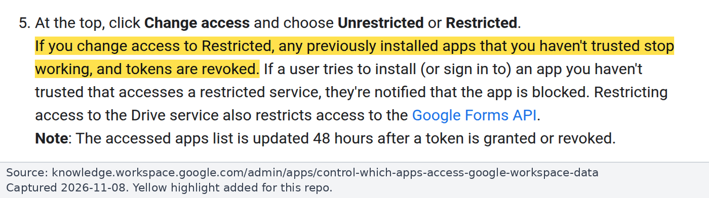

# Runbook: Google Workspace admin steps [GWA]

For the Google Workspace admins. This lists every step in the read-only Gmail plan that needs Google Workspace admin access. Background and reasoning: [findings.md](../findings.md). Sources checked on 2026-11-08.

> **Screenshots:** the images below are from Google's public help pages, including Google's own illustration of where API controls sit in the Admin console. We have no Admin console access, so there are no screenshots of the real console screens (Accessed apps, an app's access settings, Gmail service access); those steps are text only.

## Why we are asking

We want AI assistants (Claude, nexos.ai) to **read** Gmail but never send, draft, label or delete. Anthropic's built-in "Claude for Gmail" app asks Google for send permission (`gmail.compose`), so the only way to make read-only a property of the **credential** is for Google to hand out tokens that hold only `gmail.readonly`. A token holding only `gmail.readonly` (plus `openid email`) cannot send, draft, label or delete, and Google enforces this regardless of the client ([Gmail API scopes](https://developers.google.com/workspace/gmail/api/auth/scopes)).

## Privileges needed

- **API controls** (steps 1 to 5, 8): the **Service Settings** administrator privilege ([Control which apps access Google Workspace data](https://knowledge.workspace.google.com/admin/apps/control-which-apps-access-google-workspace-data)).
- **Domain-wide delegation** (step 6, only if chosen): **super admin** ([162106](https://support.google.com/a/answer/162106)).
- Not GWA but org-adjacent: creating the GCP project, Internal consent screen and OAuth client needs a **GCP project owner** in the Workspace org.

## Where the settings live

Admin console > Security > Access and data control > **API controls** > Manage App Access (also shown as Manage Third-Party App Access).

*Source: [Google Workspace Admin Help, Control which apps access Google Workspace data](https://knowledge.workspace.google.com/admin/apps/control-which-apps-access-google-workspace-data), captured 2026-11-08. Yellow highlight added.*

Per-app access levels (settings can differ per organizational unit):

| Level | Meaning |
|---|---|
| Trusted | All services |
| Limited | Unrestricted services only |
| **Specific Google data** | "Can request data access only to scopes that you specify". You must include the Sign-in scopes. "If a configured app tries to access a Google service it doesn't have permission for, the user is blocked." |
| **Blocked** | No Google data |

*Source: [Google Workspace Admin Help, Control which apps access Google Workspace data](https://knowledge.workspace.google.com/admin/apps/control-which-apps-access-google-workspace-data), captured 2026-11-08. Yellow highlight added.*

## Steps

### 1. Record what each AI app is requesting

API controls > Manage App Access > **Accessed apps**. Find and record the scopes of:

- "Claude for Gmail" (and other Claude Google apps).
- nexos.ai's Gmail app.

"Accessed apps" shows "the OAuth scopes that each app is requesting". Note them before deciding anything. Expected (Community, from user reports): "Claude for Gmail" holds `gmail.readonly` + `gmail.compose` ("Manage drafts and send emails").

### 2. Set the access level for "Claude for Gmail"

Which level depends on the route the team picks ([open-questions.md](../open-questions.md#1-is-anthropic-enforced-read-only-enough-for-gmail-or-do-you-need-a-credential-level-guarantee)):

- **Proxy route (credential-level read-only):** set to **Blocked**.
- **Built-in route (Anthropic-enforced read-only):** set to **Trusted** only for the OUs that should use it; otherwise Workspace may show "Access blocked" ([10166901](https://support.claude.com/en/articles/10166901-use-google-workspace-connectors) troubleshooting).
- **Optional test:** whether "Specific Google data" = `gmail.readonly` breaks the built-in connector. The connector always asks for `gmail.compose` too, so sign-in is **expected to fail** rather than produce a partial read-only grant (**Inferred, untested**). Use a pilot OU.

### 3. nexos.ai's Gmail app

Set it to **Blocked** (or Specific Google data) if nexos Gmail must be read-only, so a member can't get write access to Gmail through nexos.

### 4. Configure our read-only OAuth client

For the proxy's OAuth client (or the Google Gmail MCP client, if that route is chosen): set it to **Specific Google data** with `gmail.readonly` + Google sign-in scopes, or to Trusted.

This client lives in a GCP project owned by the Workspace org, with an **Internal** consent screen. Internal apps are exempt from Google's restricted-scope verification: "Internal Use apps: The app is only used by people in your Google Workspace or Cloud Identity organization" ([verification exceptions](https://support.google.com/cloud/answer/13464323)).

### 5. Optional hardening

- **Unconfigured third-party apps:** allow all (default), allow only basic Sign-in-with-Google apps, or don't allow any. Consider basic sign-in only or none.
- **"Trust internal apps":** leave it **unchecked**, so only explicitly configured clients reach Gmail.
- **Gmail service = Restricted:** only Trusted or Specific Google data apps can then access Gmail. Large blast radius: "If you change access to Restricted, any previously installed apps that you haven't trusted stop working, and tokens are revoked." Announce and coordinate first.

*Source: [Google Workspace Admin Help, Control which apps access Google Workspace data](https://knowledge.workspace.google.com/admin/apps/control-which-apps-access-google-workspace-data), captured 2026-11-08. Yellow highlight added.*

- **High-risk Gmail scopes** can be restricted separately. The list includes `gmail.compose`, `gmail.send`, `gmail.modify`, `gmail.readonly` and `mail.google.com`.

### 6. Only if chosen: domain-wide delegation (super admin)

Authorize a service account client ID for `gmail.readonly` only ([162106](https://support.google.com/a/answer/162106)). The scope floor is hard, but the service can **impersonate every user**. For an interactive assistant, per-user OAuth is safer; DWD only fits if the proxy must act without each user signing in.

### 7. Only if the Google Gmail MCP route is chosen

- Enroll in the Google Workspace **Developer Preview Program**.
- Enable the Gmail API and `gmailmcp.googleapis.com` (Gmail MCP API) in the GCP project.
- The OAuth client must be marked "Use this client for an AI-powered agent" ([Configure Gmail MCP](https://developers.google.com/workspace/gmail/api/guides/configure-mcp-server)).

### 8. Ongoing

- Review OAuth log events in the security investigation tool.
- Re-check **Accessed apps** periodically to audit Claude, nexos and the proxy.

## Effect on personal Claude accounts

On Claude Team, nothing in Claude's org settings stops a member's **personal** Claude account from connecting work Gmail. Blocking "Claude for Gmail" at Google closes that gap on any plan, but it also blocks the org's own use of the built-in connector.
