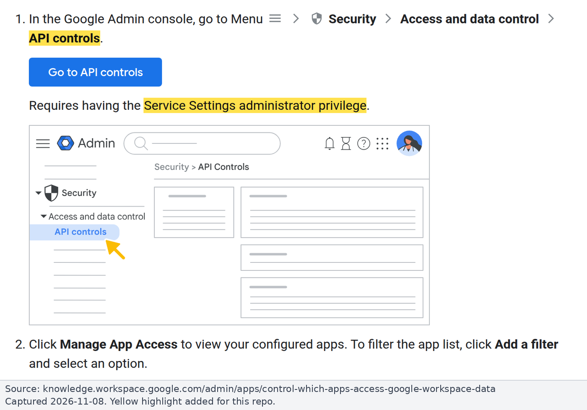
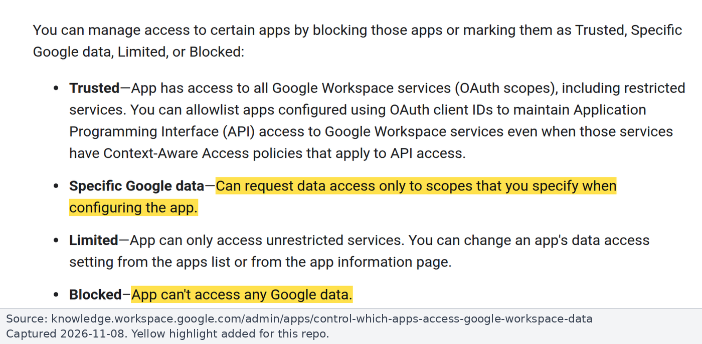

# Runbook: Google Workspace admin steps [GWA]

For Google Workspace admins: make Google hand AI apps Gmail tokens that can only read. A token with only `gmail.readonly` (plus `openid email`) can't send, draft, label or delete, whatever the app does ([Gmail API scopes](https://developers.google.com/workspace/gmail/api/auth/scopes)). Background: [findings.md](../findings.md). Checked on 2026-11-08.

**Privileges:** steps 1 to 5 and 8 need **Service Settings** admin. Step 6 needs **super admin**. Creating the GCP project and OAuth client needs a **GCP project owner** in our org.

## Where the settings live

Admin console > Security > Access and data control > **API controls** > Manage App Access.

Each app gets an access level per organizational unit (OU):

| Level | Meaning |
|---|---|
| Trusted | All services |
| Limited | Unrestricted services only |
| **Specific Google data** | Only the scopes you list (include the Sign-in scopes) |
| **Blocked** | No Google data |

*Source: [Google Workspace Admin Help](https://knowledge.workspace.google.com/admin/apps/control-which-apps-access-google-workspace-data), captured 2026-11-08.*

## Steps

### 1. Record what each AI app is requesting

Open Manage App Access > **Accessed apps**. Write down the scopes of "Claude for Gmail" (and other Claude apps) and nexos.ai's Gmail app. Users report "Claude for Gmail" holds `gmail.readonly` + `gmail.compose` (send).

### 2. Set the access level for "Claude for Gmail"

Pick by route ([questions.md](../questions.md)):

- **Proxy route:** **Blocked**.
- **Built-in route:** **Trusted** for the OUs that use it, or users may see "Access blocked" ([10166901](https://support.claude.com/en/articles/10166901-use-google-workspace-connectors)).
- Specific Google data = `gmail.readonly` will probably break sign-in, since the connector also asks for `gmail.compose` (**untested**; try a pilot OU).

### 3. nexos.ai's Gmail app

Set it to **Blocked** (or Specific Google data) so nobody gets Gmail write access through nexos.

### 4. Configure our read-only OAuth client

Set the guard's OAuth client (or the Google Gmail MCP client) to **Specific Google data** with `gmail.readonly` + sign-in scopes, or Trusted. Keep its consent screen **Internal**, which skips Google's restricted-scope verification ([exceptions](https://support.google.com/cloud/answer/13464323)).

### 5. Optional hardening

- **Unconfigured third-party apps:** allow only basic Sign-in-with-Google apps, or none.
- **"Trust internal apps":** leave unchecked.
- **Gmail service = Restricted:** only Trusted or Specific Google data apps reach Gmail. Others stop working and lose their tokens, so announce it first.
- **High-risk Gmail scopes** can be restricted separately.

### 6. Only if chosen: domain-wide delegation (super admin)

Authorize the service account for `gmail.readonly` only ([162106](https://support.google.com/a/answer/162106)). It can then **impersonate every user**, so prefer per-user OAuth.

### 7. Only if the Google Gmail MCP route is chosen

Enroll in the Workspace **Developer Preview Program**, enable the Gmail API and `gmailmcp.googleapis.com`, and mark the OAuth client "Use this client for an AI-powered agent" ([Configure Gmail MCP](https://developers.google.com/workspace/gmail/api/guides/configure-mcp-server)).

### 8. Ongoing

Review OAuth log events in the security investigation tool and re-check **Accessed apps**.

## Effect on personal Claude accounts

On Claude Team, nothing stops a member's **personal** Claude account from connecting work Gmail. Blocking "Claude for Gmail" closes that, but also blocks the org's built-in connector.
