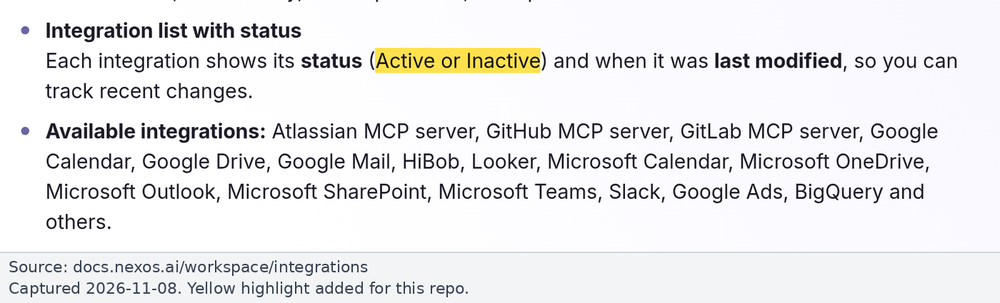
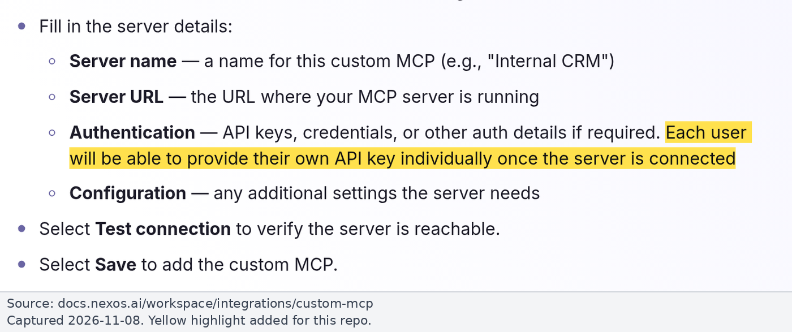
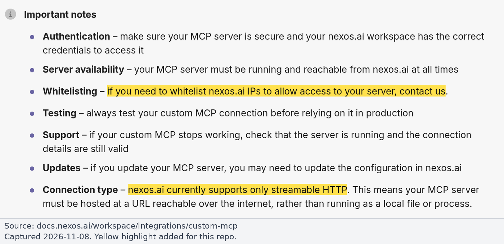
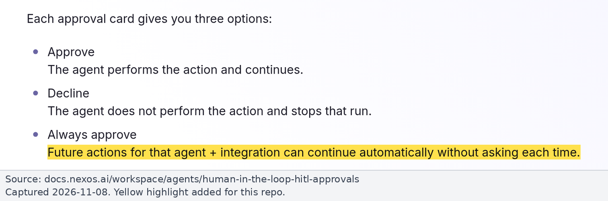
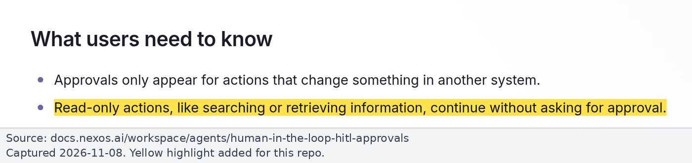
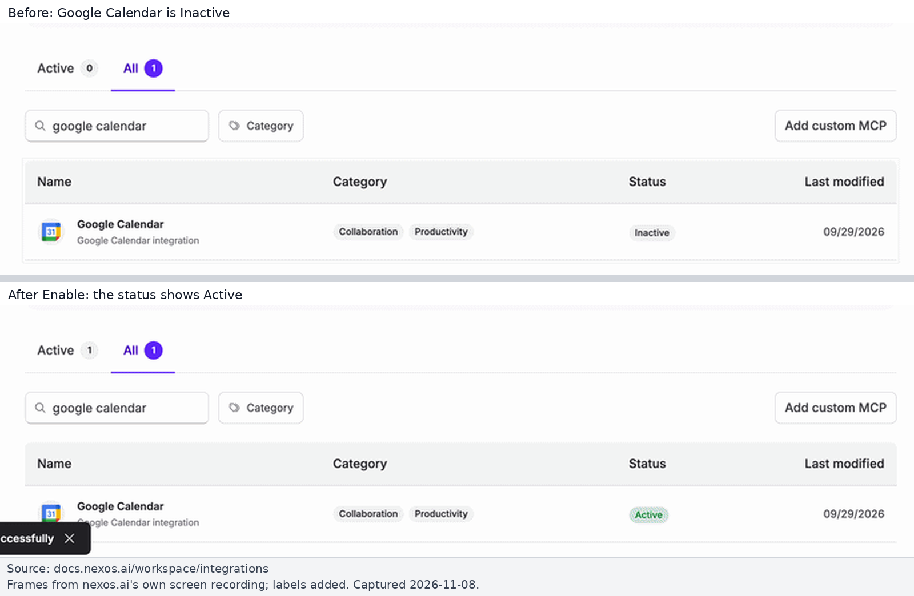
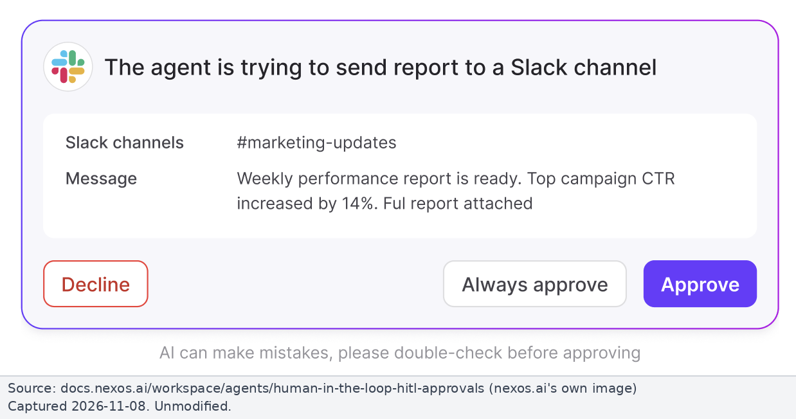
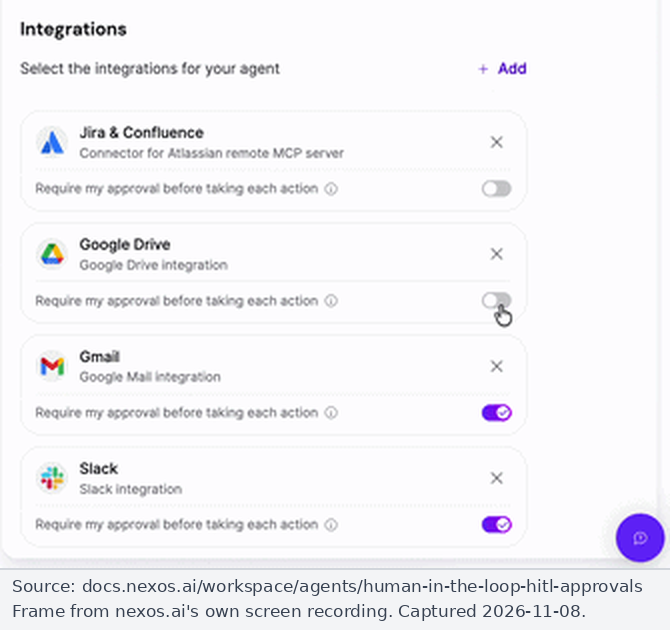

# Runbook: nexos.ai

For nexos.ai Owners. Background: [findings.md](../findings.md#5-nexosai). Sources checked on 2026-11-08.

> **Screenshots:** the images below show the cited nexos.ai docs text, plus nexos's own UI screenshots from its public docs. We have no nexos Owner access, so there are no screenshots of our own workspace.

## What nexos can and cannot restrict

| Area | What the docs say | Status |
|---|---|---|
| Built-in Gmail | Admin: Management > Apps > Gmail > **Active**. Members then connect their own Google account in Settings > My Apps, and turn Gmail on per chat (+ > Integrations) or per agent (Studio > Settings > Integrations) ([Gmail](https://docs.nexos.ai/workspace/integrations/gmail.md)) | Verified. **Tools and OAuth scopes are not documented** |
| Org controls | Settings > Organization > Integrations: Active / Inactive per integration ([Integrations](https://docs.nexos.ai/workspace/integrations.md)) | Verified. **No per-tool toggle documented** |
| Roles | Owner (org-wide incl. apps), Team Owner (team models; "Apps remain managed at the company level"), User ([Roles](https://docs.nexos.ai/workspace/settings/organization/roles-and-permissions.md), [Teams](https://docs.nexos.ai/workspace/settings/organization/teams.md)) | Verified. **No team-level integration or tool restriction** |
| Approvals (HITL) | Agent pauses before "an action that changes something in another tool". Per-integration toggle inside each agent's settings. "Always approve" exists. "Read-only actions ... continue without asking" ([HITL](https://docs.nexos.ai/workspace/agents/human-in-the-loop-hitl-approvals.md)). [Changelog](https://docs.nexos.ai/changelog/changelog/latest-updates.md) (Jun 29): "works in both chat-based workflows and Agents" | Verified. **Advisory**: each user can switch to "Always approve". How nexos decides read vs write isn't documented (possibly MCP annotations; Inferred) |
| Custom MCP | Management > Apps > Add custom MCP. **Streamable HTTP only, internet-reachable.** Auth: "API keys, credentials ... Each user will be able to provide their own API key individually". Org-level: "all teams and members in your workspace can use them once enabled". IP allowlisting on request ([Custom MCP](https://docs.nexos.ai/workspace/integrations/custom-mcp.md)) | Verified. OAuth for custom MCP not documented |
| Plans | Billing shows "1-month plan, 12-month plan, or Enterprise" ([Billing](https://docs.nexos.ai/workspace/settings/organization/billing.md)). nexos.ai/pricing was not readable | No doc ties integration controls to a plan |

*Source: [nexos.ai docs, Workspace Integrations](https://docs.nexos.ai/workspace/integrations.md), captured 2026-11-08. Yellow highlight added.*

*Source: [nexos.ai docs, Custom MCP](https://docs.nexos.ai/workspace/integrations/custom-mcp.md), captured 2026-11-08. Yellow highlight added.*

*Source: [nexos.ai docs, Custom MCP](https://docs.nexos.ai/workspace/integrations/custom-mcp.md), captured 2026-11-08. Yellow highlight added.*

*Source: [nexos.ai docs, Human-in-the-Loop approvals](https://docs.nexos.ai/workspace/agents/human-in-the-loop-hitl-approvals.md), captured 2026-11-08. Yellow highlight added.*

*Source: [nexos.ai docs, Human-in-the-Loop approvals](https://docs.nexos.ai/workspace/agents/human-in-the-loop-hitl-approvals.md), captured 2026-11-08. Yellow highlight added.*

*Source: [nexos.ai docs, Workspace Integrations](https://docs.nexos.ai/workspace/integrations.md), frames from nexos.ai's own screen recording, captured 2026-11-08. Labels added.*

*Source: [nexos.ai docs, Human-in-the-Loop approvals](https://docs.nexos.ai/workspace/agents/human-in-the-loop-hitl-approvals.md), nexos.ai's own image, captured 2026-11-08.*

*Source: [nexos.ai docs, Human-in-the-Loop approvals](https://docs.nexos.ai/workspace/agents/human-in-the-loop-hitl-approvals.md), frame from nexos.ai's own screen recording, captured 2026-11-08.*

**Conclusion:** in nexos the only enforced read-only Gmail is a read-only MCP server added as a custom MCP, with the built-in Gmail integration Inactive. Claude's org policy does not cover nexos at all.

## Steps

1. **Turn off built-in Gmail:** Settings > Organization > Integrations (Management > Apps) > Gmail > **Inactive**.
2. **[GWA] Close the Google side:** ask the Workspace admins to find nexos's Gmail OAuth app under Accessed apps, record its scopes, and set it to **Blocked** (or Specific Google data) so a member can't get write access to Gmail through nexos ([google-workspace-admin.md](google-workspace-admin.md#3-nexosais-gmail-app)).
3. **Ask nexos** (support / account contact):
   - Does custom MCP support **OAuth**? If yes, the proxy's personal-key mode can be dropped.
   - The IP ranges nexos calls custom MCP servers from (IP allowlisting is available on request), so the proxy can be firewalled.
   - Which plan the org is on and whether any integration controls depend on it.
4. **Add the read-only proxy as a custom MCP** (once it exists, see [proxy-design.md](../proxy-design.md)): Management > Apps > Add custom MCP, Streamable HTTP, the proxy URL. Each user signs in on the proxy's web page, gets a revocable **personal key**, and pastes it into nexos ([personal key flow](../proxy-design.md#auth-flow-nexos-personal-key-mode)).
5. **Do not rely on HITL** as the read-only control; it is advisory.

## Claude Code through the nexos gateway

nexos documents running Claude Code through its gateway with `ANTHROPIC_BASE_URL=https://api.nexos.ai` and `ANTHROPIC_AUTH_TOKEN` ([nexos Claude Code integration](https://docs.nexos.ai/gateway-api/integrations/claude-code.md)). Such sessions get neither claude.ai connectors nor server-managed settings. **Only MDM or file-deployed managed settings govern them** ([claude-code-managed-settings.md](claude-code-managed-settings.md)).

## Payhawk in nexos

nexos.ai is **not** on Payhawk's list of AI apps allowed to sign in, so even the direct Payhawk MCP won't sign in from nexos today. See [payhawk.md](payhawk.md).
