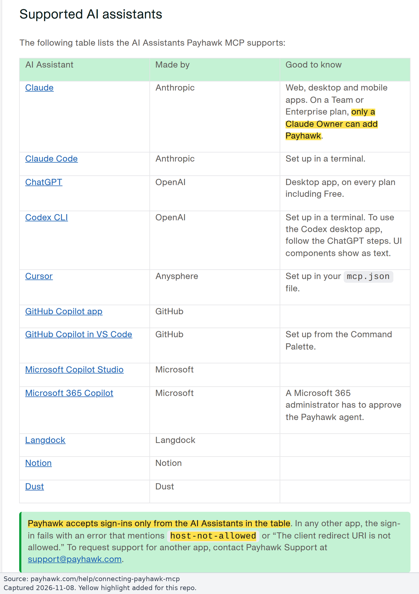
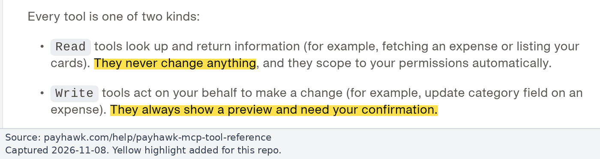
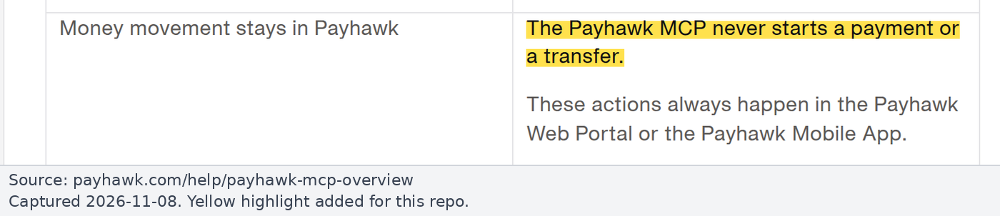

# Runbook: Payhawk MCP

For Claude Owners and Payhawk admins. Background: [findings.md](../findings.md#65-payhawk-mcp). Sources checked on 2026-11-08: Payhawk Help Center [About](https://payhawk.com/help/payhawk-mcp-overview.md) (2026-10-28), [Connecting](https://payhawk.com/help/connecting-payhawk-mcp.md), [Tool reference](https://payhawk.com/help/payhawk-mcp-tool-reference.md) (2026-09-15), [FAQ](https://payhawk.com/help/faq-on-the-payhawk-mcp.md), [Troubleshooting](https://payhawk.com/help/troubleshooting-the-payhawk-mcp.md), [Developer API](https://payhawk.com/help/overview-of-the-payhawk-developer-api.md).

> **Screenshots:** the Payhawk Help Center has no screenshots of the connection or admin screens, and we have no Payhawk admin access, so the steps are text only. The images below show the cited help-page text.

## Key facts

- **Official, hosted by Payhawk:** `https://mcp.payhawk.com/mcp` (Streamable HTTP). Not in app directories; added manually.
- **Auth:** OAuth with the user's own Payhawk login. Dynamic registration works ("Register automatically" in Claude). Sessions last until 7 days unused, 30 days at most. The AI "sees exactly what you see in Payhawk", so Payhawk roles still apply.
- **Client allowlist:** "Payhawk accepts sign-ins only from the AI Assistants in the table. In any other app, the sign-in fails with an error that mentions `host-not-allowed` or 'The client redirect URI is not allowed.'" Supported: Claude, Claude Code, ChatGPT, Codex CLI, Cursor, GitHub Copilot app and VS Code, Microsoft Copilot Studio, M365 Copilot, Langdock, Notion, Dust. **nexos.ai is not on the list.** Requests for other apps go to support@payhawk.com.
- **Write safety on Payhawk's side:** "Write tools ... always show a preview and need your confirmation". It "never starts a payment or a transfer". This is a user-confirmation gate (advisory), not a read-only mode.
- **Developer API:** keys are **Full access** or **Read-only access** (Settings > Integrations > API). A key is account-wide, not per user, and rate limited to 15 requests/s.

*Source: [Payhawk Help Center, Connecting Payhawk to your AI Assistant](https://payhawk.com/help/connecting-payhawk-mcp.md), captured 2026-11-08. Yellow highlight added.*

*Source: [Payhawk Help Center, Payhawk MCP tool reference](https://payhawk.com/help/payhawk-mcp-tool-reference.md), captured 2026-11-08. Yellow highlight added.*

*Source: [Payhawk Help Center, About the Payhawk MCP](https://payhawk.com/help/payhawk-mcp-overview.md), captured 2026-11-08. Yellow highlight added.*

## Options

| Option | Covers | Enforcement | Per-user Payhawk permissions | Status |
|---|---|---|---|---|
| **A. Direct custom connector in Claude, write + ambiguous tools Blocked** | Claude only | Anthropic server-side | Kept | Works today, no code |
| **B. Payhawk proxy with per-user Payhawk OAuth** | Claude, Claude Code, nexos | Proxy default-deny allowlist | Kept | Blocked until **Payhawk Support allowlists the proxy redirect URI** |
| **C. Payhawk proxy on a Read-only Developer API key** | Claude, Claude Code, nexos | Read-only key + proxy | **Lost**: one shared account-wide credential; every user sees everything the key sees. Not recommended for finance data | Works today |

Separately, Payhawk roles limit what each user's MCP session can do. A finance-light role is another hard floor, but it is per user and not per tool.

## Option A steps (Claude only)

1. Claude Owner: Organization settings > Connectors > Add custom connector, URL `https://mcp.payhawk.com/mcp`, OAuth client "Register automatically". "Only a Claude Owner can add a custom connector."
2. In the connector's tool permissions, set **every Write and every Ambiguous tool** (table below) to **Blocked**. Read tools: Always allow or Needs approval.
3. Members connect individually with their own Payhawk login.
4. Claude Code picks up the org policy automatically for logged-in sessions; see [claude-code-managed-settings.md](claude-code-managed-settings.md) for other sessions.

## Option B steps (proxy)

1. **Start early (external lead time):** email support@payhawk.com asking them to allow the proxy's OAuth redirect URI (e.g. `https://payhawk-ro.example.com/auth/callback`). Until then, per-user Payhawk OAuth from a proxy fails with `host-not-allowed`.
2. Once allowed, deploy the proxy as an `mcp` upstream in front of `https://mcp.payhawk.com/mcp` ([proxy-design.md](../proxy-design.md#payhawk)).
3. Call `tools/list` once and record each tool's `annotations` and input schema. Payhawk's docs don't say whether it publishes annotations.
4. Pin the read allowlist from the table below; everything else is denied by default.
5. If Payhawk declines: decide between Option C (shared Read-only key) and Option A (Claude only).

## Tool classification (82 tools)

Payhawk doesn't mark each tool read or write. The split below is **Inferred from the names** plus Payhawk's rule that read tools "never change anything". **Default-deny anything unclear.**

| Class | Tools |
|---|---|
| **Read** (allowlist candidates) | `list_expenses`, `get_expense`, `get_expense_approval_status`, `list_expense_payments`, `list_documents`, `get_invoice_inbox`, `list_close_blockers`, `list_expense_reports`, `get_expense_report`, `list_expense_subscriptions`, `list_mileage_claims`, `list_cards`, `get_card`, `list_card_requests`, `get_card_request`, `list_fund_accounts`, `get_fund_account`, `list_balances`, `list_fund_account_activity`, `get_upcoming_payments`, `get_transaction`, `get_fx_rate`, `review_queue`, `needs_my_attention`, `get_approval_request`, `list_audit_logs`, `list_suppliers`, `get_supplier`, `list_purchase_orders`, `get_purchase_order`, `list_purchase_order_types`, `list_merchants`, `get_merchant`, `list_card_acceptance_opportunities`, `list_export_history`, `list_failed_exports`, `list_export_templates`, `list_account_codes`, `list_tax_rates`, `list_custom_fields`, `list_expense_categories`, `get_expense_category`, `list_accounts`, `list_users`, `get_user`, `list_teams`, `list_team_members`, `list_spend_policies`, `get_spend_policy`, `list_comments`, `get_job_status`, `get_agent_job_status`, `product_help`, `list_playbooks`, `get_playbook` |
| **Write** (deny) | `upload_document`, `ingest_and_auto_match_receipt`, `create_expense`, `submit_expense`, `recode_expense`, `confirm_expense_subscription`, `manage_expense_subscription`, `update_card_status` (freeze/unfreeze/close), `create_card_request`, `approve_or_return`, `complete_expense_review`, `return_expense_for_review`, `out_of_office_delegate`, `manage_supplier`, `manage_purchase_order`, `run_export`, `manage_spend_policy`, `add_comment`, `submit_feedback`, `draft_playbook`, `manage_playbook` |
| **Ambiguous** (deny until verified) | `budgets` (one tool, may read or manage), `travel_agent`, `procurement_agent`, `payments_agent` (agents that can act), `dispatch_widget_action` (runs widget buttons), `insights_query_async` (read analysis but starts background jobs) |

## Recommendation

- **Claude only:** Option A. Enforced server-side, no code, per-user Payhawk permissions kept.
- **Claude and nexos, or a credential-level guarantee:** Option B, which needs Payhawk Support to allowlist the proxy redirect URI. Note that even the direct Payhawk MCP won't sign in from nexos today.
